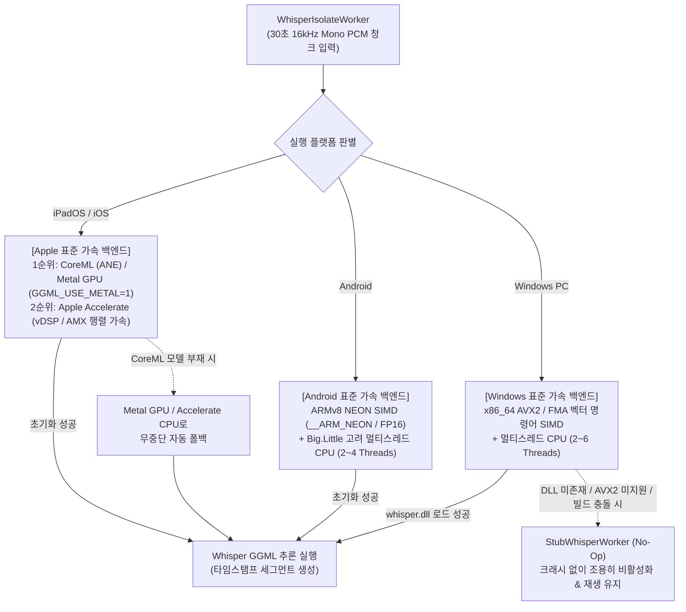
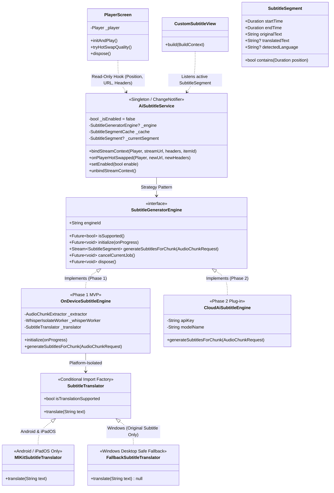
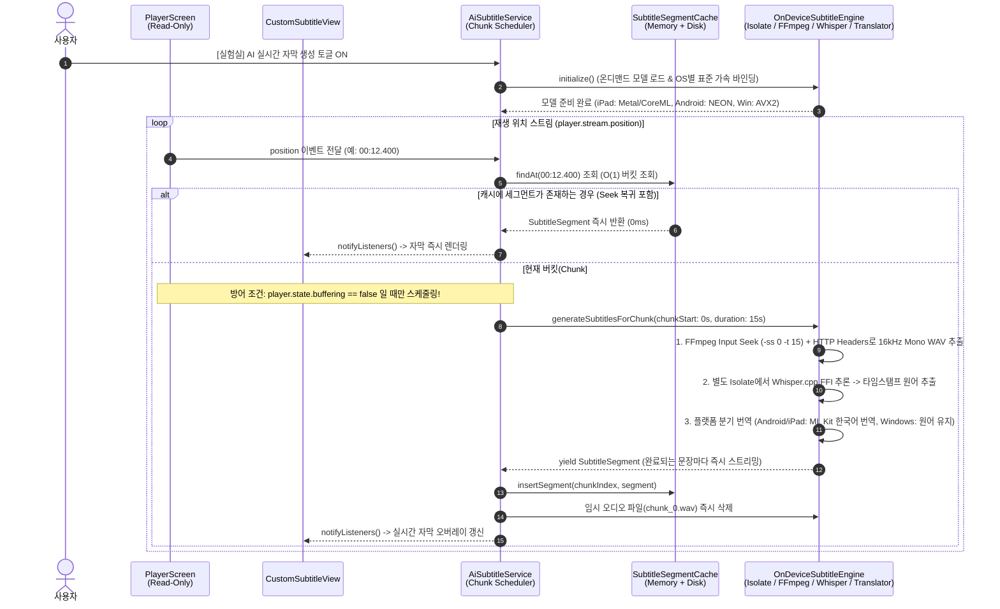

# [아키텍처 설계서] 동영상 음성 인식(STT) 및 실시간 자막 번역 시스템 (Phase 1 & Phase 2 확장형)

> **문서 목적**: 현재 다중 클라우드 미디어 플레이어(`cloud_media_player` - Android / iPadOS / Windows 지원)의 기존 재생·스트리밍·화질 핫스왑·자막 파이프라인에 **어떠한 사이드 이펙트(성능 저하, 재생 끊김, 네트워크 대역폭 경쟁, 크로스 플랫폼 빌드 깨짐)도 주지 않고**, 독립 모듈 형태의 **'[실험실] AI 실시간 자막 생성 및 번역'** 기능을 도입하기 위한 구조 변경 계획안입니다.

---

## 0. 현행 시스템(`pubspec.yaml` 및 스트리밍/자막 구조) 정밀 분석 결과

현재 프로젝트의 코드베이스를 분석한 결과, AI 자막 모듈 설계 시 반드시 고려해야 할 **4가지 핵심 아키텍처 특성**은 다음과 같습니다.

1. **`media_kit` (`libmpv`) 기반 단일/듀얼 플레이어 구조 ([`player_screen.dart`](file:///D:/My%20Documents/AI/cloud_media_player/lib/ui/screens/player_screen.dart))**:
   - 현재 `media_kit: ^1.2.6` 및 `media_kit_video: ^2.0.1`을 사용 중이며, `PlayerConfiguration(bufferSize: 64 * 1024 * 1024)` 및 `demuxer-readahead-secs: 30`이 설정되어 있습니다.
   - 특히 해상도 변경(`360p` ↔ `720p` ↔ `Original`) 시 [`_tryHotSwapQuality()`](file:///D:/My%20Documents/AI/cloud_media_player/lib/ui/screens/player_screen.dart#L2473-L2763)를 통해 백그라운드 `_standbyPlayer`를 생성한 뒤 메인 `_player` 인스턴스 자체를 교체(Hot-Swap)합니다.
   - **설계 반영**: `AiSubtitleService`는 특정 `Player` 인스턴스에 강결합되지 않고, 핫스왑 시에도 **기존에 생성된 타임스탬프 기반 자막 캐시(`SubtitleSegment`)를 그대로 유지**하면서 `Position` 스트림 구독만 새 `Player`로 심리스하게 재바인딩(`onPlayerHotSwapped`)해야 합니다.

2. **클라우드별 이종 스트리밍 프로토콜 및 [`LocalStreamProxy`](file:///D:/My%20Documents/AI/cloud_media_player/lib/services/local_stream_proxy.dart) 병목 방어**:
   - **Google Drive / Dropbox / Box / OneDrive / WebDAV**: 원격 URL + `Authorization` / `Cookie` 헤더를 `libmpv`에 직접 전달합니다.
   - **Baidu / TeraBox (HLS `.m3u8`)**: `LocalStreamProxy`(`http://127.0.0.1:<port>/stream?session=<id>`)가 M3U8 내부의 `.ts` 세그먼트와 암호화 키 URL을 로컬 프록시로 재작성(Rewrite)하고, 세션당 동시 세그먼트 요청을 **`_Gate(3)` 세마포어**로 제한합니다.
   - **Naver MYBOX & MEGA**: `LocalStreamProxy`를 경유하며, 특히 MEGA는 프록시 내부([`_handleMegaStream`](file:///D:/My%20Documents/AI/cloud_media_player/lib/services/local_stream_proxy.dart#L441-L501))에서 AES-CTR 실시간 복호화 및 HTTP Byte-Range 응답(`video/mp4`)을 수행합니다.
   - **설계 반영**:
     - AI 오디오 추출기가 로컬 프록시 URL(`127.0.0.1`)을 읽으면 **MEGA 복호화 및 Baidu/TeraBox/Naver 인증 헤더가 자동 해결**되는 큰 이점이 있습니다.
     - 단, Baidu/TeraBox HLS 재생 중 `_Gate(3)` 세마포어를 비디오 플레이어와 경쟁하지 않도록, **① 플레이어가 버퍼링 중(`player.state.buffering == true`)일 때는 오디오 청크 추출을 일시 유예(Yield)**하고, **② 오디오 추출용 프록시 접근은 동시 요청 수를 최대 1개(Low-Priority Single Flight)**로 제한합니다.

3. **완전 분리된 커스텀 자막 렌더링 레이어 ([`custom_subtitle_view.dart`](file:///D:/My%20Documents/AI/cloud_media_player/lib/ui/widgets/custom_subtitle_view.dart))**:
   - `Video` 위젯의 기본 자막 뷰는 비활성화(`SubtitleViewConfiguration(visible: false)`)되어 있으며, 모든 자막은 `Stack` 위의 [`CustomSubtitleView`](file:///D:/My%20Documents/AI/cloud_media_player/lib/ui/widgets/custom_subtitle_view.dart#L7-L184)가 [`SubtitleSettingsService`](file:///D:/My%20Documents/AI/cloud_media_player/lib/services/subtitle_settings_service.dart)의 스타일(폰트 크기, 위치, 여백, 글자색, 배경 투명도)을 구독하여 렌더링합니다.
   - **설계 반영**: 기존 `libmpv`의 자막 트랙(`player.stream.subtitle`)을 건드리지 않고, `CustomSubtitleView` 내부에서 `AiSubtitleService`의 활성화 여부만 확인하여 **기존 자막 스타일 그대로 원어 + 번역어 2줄(또는 원어/번역어 단독)을 오버레이 렌더링**할 수 있습니다.

4. **타임라인 썸네일 캡처 및 재생 이력 동기화 보호**:
   - 재생 5초 경과 또는 일시정지/종료 시 `_player.screenshot()`을 호출하는 [`_captureThumbnailIfNeeded()`](file:///D:/My%20Documents/AI/cloud_media_player/lib/ui/screens/player_screen.dart#L1496-L1527)와 5초 주기의 [`_saveCurrentPosition()`](file:///D:/My%20Documents/AI/cloud_media_player/lib/ui/screens/player_screen.dart#L1585-L1610)이 메인 UI 스레드에서 동작합니다.
   - **설계 반영**: 오디오 추출(FFmpeg) 및 STT 추론(Whisper)은 **100% 별도 백그라운드 워커 Isolate / 네이티브 비동기 프로세스**에서 실행하여 메인 UI 스레드 프레임 드랍(Jank)을 0%로 유지합니다.

---

## 1. 플랫폼별 패키지 호환성, 하드웨어 가속 및 분기 전략

본 프로젝트는 **PC(Windows)**, **Android**, **iPadOS(iOS)** 3개 타겟 플랫폼에서 단일 코드베이스로 컴파일 및 배포됩니다(GitHub Actions iOS IPA 빌드 및 Windows CMake 빌드 포함).
기종별 NPU/칩셋 파편화로 인한 빌드 깨짐을 원천 차단하고 각 OS의 표준 하드웨어 가속을 극대화하기 위해 아래 백엔드 및 조건부 임포트(Conditional Import) 전략을 적용합니다.

### 1.1. 파이프라인 단계별 플랫폼 호환성 & 하드웨어 가속 매트릭스

| 파이프라인 단계 | Android (ARM64 / x86_64) | iPadOS / iOS (Apple Silicon) | Windows Desktop (x64) | 미지원/예외 시 Fail-Safe Fallback |
| :--- | :--- | :--- | :--- | :--- |
| **① 오디오 청크 추출**<br/>*(16kHz, Mono, PCM WAV)* | **`ffmpeg_kit_flutter_new`**<br/>*(audio/min 패키지)*<br/>네이티브 `.so` 비동기 실행 | **`ffmpeg_kit_flutter_new`**<br/>*(audio/min 프레임워크)*<br/>네이티브 비동기 실행 | **Windows 전용 `FfmpegCliExtractor`**<br/>*(번들 경량 `ffmpeg.exe` 또는 시스템 PATH `Process.run`)* | FFmpeg 바이너리 부재/실패 시 오디오 추출을 즉시 중단하고 기존 재생 유지 (배너 1회 알림) |
| **② 온디바이스 STT**<br/>*(Whisper.cpp FFI)* | **ARM NEON SIMD + 멀티스레드 CPU 가속**<br/>*(FP16 내적 연산 + 스레드 수 제한)* | **Metal GPU / CoreML + Accelerate 가속**<br/>*(CoreML 미존재 시 Metal 자동 폴백)* | **AVX2 벡터 명령어 + 멀티스레드 CPU 가속**<br/>*(`whisper.dll` 동적 FFI 로드)* | 네이티브 DLL/SO 심볼 로드 실패 또는 구형 CPU 명령어 미지원 시 **`StubWhisperEngine`으로 안전 폴백** |
| **③ 온디바이스 번역**<br/>*(Conditional Import)* | **`google_mlkit_translation`**<br/>*(모바일 타겟 전용 컴파일/로드)* | **`google_mlkit_translation`**<br/>*(모바일 타겟 전용 컴파일/로드)* | **`DesktopOriginalOnlyTranslator`**<br/>*(ML Kit 의존성 완전 격리)* | **Windows에서는 ML Kit을 로드하지 않고 Phase 1에서 원어(STT) 자막만 우선 출력** |

---

### 1.2. [핵심 지시 1] STT(Whisper) 플랫폼별 하드웨어 가속 백엔드 자동 최적화 전략

> **[설계 원칙 - 벤더 종속 NPU SDK 배제]**
> Qualcomm QNN/SNPE, MediaTek NeuroPilot, Windows DirectML 등 **벤더별 독점 NPU SDK 직접 연동은 드라이버 파편화, ABI 충돌, CMake/Gradle 빌드 실패 리스크가 매우 크므로 아키텍처에서 완전히 배제**합니다.
> 대신 **`whisper.cpp` (GGML 텐서 엔진) 계열의 C ABI FFI 바인딩**을 사용하여 각 OS 커널/컴파일러가 기본 보장하는 **표준 하드웨어 가속 백엔드로 자동 폴백(Auto-Fallback)**되도록 구성합니다.



1. **iPadOS (Apple A-Series / M-Series 칩셋): Metal / CoreML + Accelerate 가속**
   - `whisper.cpp`의 iOS/iPadOS 빌드 플래그에서 **`GGML_USE_METAL=1`** 및 **`GGML_USE_ACCELERATE=1`**을 기본 활성화합니다.
   - CoreML(`WHISPER_COREML=1` & `WHISPER_COREML_ALLOW_FALLBACK=1`)이 활성화된 환경에서는 Apple Neural Engine(ANE)을 우선 활용하되, 별도의 CoreML 인코더(`.mlmodelc`) 파일이 없는 경우에도 **런타임 에러 없이 즉시 Metal GPU 셰이더 및 Accelerate(`vDSP`/AMX 코프로세서)로 자동 폴백**되어 단일 GGML 양자화 모델 파일(`ggml-tiny-q5_1.bin`)만으로도 초고속 추론(30초 오디오 기준 1~2초 소요)이 동작하도록 구성합니다.

2. **Android (Snapdragon / Exynos / Dimensity / Tensor 공통): ARM NEON SIMD + 멀티스레드 CPU 가속**
   - 특정 제조사 NPU에 의존하지 않고 모든 64비트 안드로이드(`arm64-v8a`)에서 100% 호환되는 **ARM NEON SIMD 벡터 내적 명령어(`-O3`, `__ARM_NEON`, FP16)**와 멀티스레드 CPU 가속을 사용합니다.
   - **비디오 디코더(`mediacodec`) 보호를 위한 스레드 캡핑(Thread Capping)**:
     - 안드로이드에서 `whisper.cpp`가 모든 CPU 코어를 100% 점유하면 `libmpv`의 오디오/비디오 동기화 스레드가 기아(Starvation) 상태에 빠질 수 있습니다.
     - 따라서 추론 워커 스레드 수를 `final threads = (Platform.numberOfProcessors - 2).clamp(2, 4);`로 제한하여 **최소 2개 이상의 코어를 항상 비디오 플레이어와 UI 스레드에 남겨둡니다**.

3. **Windows (x86_64 데스크톱/노트북): AVX2 벡터 명령어 + 멀티스레드 CPU 가속 & 동적 DLL 폴백**
   - Windows에서는 **AVX2 / AVX / FMA 벡터 명령어** 및 멀티스레드 CPU(`threads = (Platform.numberOfProcessors ~/ 2).clamp(2, 6)`)로 컴파일된 네이티브 `whisper.dll`을 `dart:ffi`의 `DynamicLibrary.open('whisper.dll')`로 **런타임 동적 로드(Dynamic Loading)**합니다.
   - **CMake 네이티브 빌드 충돌 원천 방어**:
     - Windows Visual Studio(MSVC) CMake 빌드 시 외부 C++ 플러그인과의 컴파일 플래그 충돌(`/WX` 경고 에러 처리, `_HAS_EXCEPTIONS=0` 등 [`windows/CMakeLists.txt`](file:///D:/My%20Documents/AI/cloud_media_player/windows/CMakeLists.txt#L40-L46) 제약)로 인해 전체 앱 빌드가 깨지는 것을 막기 위해, Dart FFI 로더를 `try-catch`로 감쌉니다.
     - 만약 `whisper.dll`이 번들되지 않았거나 구형 PC에서 AVX2 명령어가 지원되지 않아 심볼 로드에 실패하면, **즉시 `StubWhisperWorker`로 자동 폴백**하여 컴파일/런타임 에러 없이 플레이어가 정상 구동되도록 보장합니다.

4. **앱 설치 용량 증가 0MB 보장 (On-Demand 모델 다운로드)**:
   - `ggml-tiny-q5_1.bin`(~31MB) 또는 `ggml-tiny.bin`(~75MB) 모델은 앱 번들(`assets/`)에 포함하지 않고, 사용자가 최초로 `[실험실] AI 실시간 자막 생성` 토글을 `ON`으로 켤 때만 `getApplicationSupportDirectory()/ai_models/`에 1회 다운로드 후 재사용합니다.

---

### 1.3. [핵심 지시 2] 번역 엔진 플랫폼 분기 (Conditional Import & Windows 의존성 완전 격리)

- **문제 정의**:
  - `google_mlkit_translation`은 **Android와 iOS(iPadOS) 전용 플러그인**입니다.
  - Windows 환경에서 `google_mlkit_translation` 클래스를 직접 호출하거나 초기화하면 런타임에 `MissingPluginException`이 발생하며, 플랫폼 분기가 불완전할 경우 데스크톱/웹 타겟 컴파일 또는 테스트 환경에서 의존성 충돌을 일으킬 수 있습니다.
- **해결 아키텍처 (Dart Conditional Import + 플랫폼 격리 어댑터)**:
  1. **조건부 임포트(Conditional Import) 및 플랫폼 팩토리 구조**:
     - `lib/services/ai_subtitle/translators/subtitle_translator.dart`는 순수 Dart 인터페이스만 노출하고, 내부에서 `google_mlkit_translation`을 직접 import하지 않습니다.
     - 플랫폼별 구현체를 분리하여 **Android / iPadOS 타겟에서만 ML Kit 번역 엔진이 로드 및 실행**되고, **Windows 환경에서는 ML Kit 코드가 전혀 실행되지 않고 원어(STT) 자막만 안전하게 출력(`translatedText = null`)**하도록 격리합니다.

```dart
// [설계 예시] lib/services/ai_subtitle/translators/subtitle_translator.dart
import 'subtitle_translator_stub.dart'
    if (dart.library.io) 'subtitle_translator_io_factory.dart';

abstract class SubtitleTranslator {
  /// 현재 플랫폼에서 로컬 번역기가 동작 가능한지 여부 (Android/iOS: true, Windows: false)
  bool get isTranslationSupported;

  /// 번역 엔진 및 언어팩 온디맨드 초기화
  Future<void> initialize({required String sourceLang, String targetLang = 'ko'});

  /// 원어 텍스트를 한국어로 번역 (미지원 플랫폼이나 실패 시 null 반환 -> 원어 자막만 표시)
  Future<String?> translate(String originalText);

  /// 리소스 해제
  Future<void> dispose();

  /// 플랫폼별 안전한 인스턴스 생성 팩토리
  factory SubtitleTranslator.create() => createPlatformSubtitleTranslator();
}
```

- **플랫폼별 런타임 동작 분기**:
  - **Android & iPadOS (`MlKitSubtitleTranslator`)**:
    - `OnDeviceTranslatorModelManager`를 통해 원본 언어(영어/일본어/중국어 등) → 한국어(`TranslateLanguage.korean`) 모델(~30MB) 다운로드 여부를 확인하고 온디바이스 오프라인 번역을 수행합니다.
    - 화면에는 **`원어 자막 (윗줄) + 한국어 번역 자막 (아랫줄)`** (또는 설정에 따라 한국어 번역 단독)이 표시됩니다.
  - **Windows Desktop (`WindowsOriginalOnlyTranslator`)**:
    - `isTranslationSupported => false`를 반환하며, `translate()` 호출 시 즉시 `null`을 반환합니다.
    - 화면에는 **`Whisper가 인식한 원어 자막`**만 깔끔하게 출력되며, 토글 활성화 시 1회 알림 배너로 *"Windows 환경에서는 온디바이스 원어 자막(STT) 모드로 동작합니다"*라고 안내합니다. (추후 Phase 2에서 Gemini API 등 클라우드 번역 엔진 연결 시 Windows에서도 즉시 번역 활성화 가능)

---

### 1.4. 오디오 스트림 청크 추출 전략 (`AudioChunkExtractor` - HTTP Range / HLS 고속 추출)

- **대용량 클라우드 영상(2GB~10GB) 전체 다운로드 원천 차단**:
  - FFmpeg 명령어 구성 시 **`-ss <시작초>` 옵션을 반드시 `-i "<URL>"` 앞에 배치(Input Seeking)**합니다.
  - 이를 통해 FFmpeg 디먹서가 스트림 전체를 처음부터 받지 않고, **HTTP `Range: bytes=...` 헤더 또는 HLS `.m3u8`의 해당 타임스탬프 `.ts` 세그먼트만 정밀 요청**하여 30초 분량(약 500KB~1.5MB)만 초고속으로 추출합니다.
- **표준 추출 파라미터 (16kHz, Mono, 16-bit PCM WAV)**:
  ```text
  -nostdin -y -loglevel error
  -headers "Authorization: Bearer ...\r\nCookie: ...\r\nUser-Agent: ...\r\n"
  -ss {startSec} -t {durationSec}
  -i "{playUrl}"
  -vn -sn -dn
  -ac 1 -ar 16000 -c:a pcm_s16le -f wav "{tempChunkPath}.wav"
  ```
- **플랫폼별 실행기 분기**:
  - **Android & iPadOS**: `MobileFfmpegExtractor` (`ffmpeg_kit_flutter_new` 비동기 세션 실행)
  - **Windows**: `DesktopFfmpegExtractor` (앱 폴더 내 `ffmpeg.exe` 또는 시스템 PATH의 `ffmpeg`를 `Process.start` 비동기로 실행하며, 실행 파일이 없을 경우 에러 없이 추출을 스킵하는 Fail-Safe 적용)

---

## 2. 최소 침습 수정 파일 목록 (Minimal Invasive Modification List)

기존 코드의 안정성을 100% 보존하기 위해 **기존 파일 수정은 단 5개 파일(단순 Read-Only 훅 연결 및 설정 UI 추가)**로 제한하고, 모든 AI 자막 비즈니스 로직은 **`lib/models/ai_subtitle/`** 및 **`lib/services/ai_subtitle/`** 하위 신규 파일로 완전 격리합니다.

### 2.1. 기존 파일 수정 목록 (최소 침습 Hook 연결 - 총 5개 파일)

| 순번 | 대상 파일 경로 | 수정 범위 및 상세 내용 (침습도) | 사이드 이펙트 방어 대책 |
| :---: | :--- | :--- | :--- |
| **1** | [`pubspec.yaml`](file:///D:/My%20Documents/AI/cloud_media_player/pubspec.yaml) | **의존성 추가 (낮음)**<br/>- 오디오 추출(`ffmpeg_kit_flutter_new`), 온디바이스 Whisper FFI, `google_mlkit_translation` 패키지 추가 | 기존 `media_kit`, `http`, `dio`, `pointycastle` 등의 버전은 일절 변경하지 않음 |
| **2** | [`lib/models/subtitle_settings.dart`](file:///D:/My%20Documents/AI/cloud_media_player/lib/models/subtitle_settings.dart) | **필드 확장 (매우 낮음)**<br/>- `showAiDualSubtitle` (원어+번역 동시 표시 여부, 기본값 `true`), `aiSourceLanguage` (기본값 `'auto'`) 등 자막 표시 옵션만 선택적 추가 *(실험실 ON/OFF 상태 자체는 안전을 위해 `AiSubtitleService`에서 기본값 `OFF`로 관리)* | 기존 `fontSize`, `position`, `textColor`, `backgroundColor` 직렬화 키 호환성 100% 유지 |
| **3** | [`lib/ui/widgets/subtitle_dialog.dart`](file:///D:/My%20Documents/AI/cloud_media_player/lib/ui/widgets/subtitle_dialog.dart) | **UI 토글 스위치 추가 (낮음)**<br/>- `_buildTrackListTab()` 내에 **`[실험실] AI 실시간 자막 생성`** `SwitchListTile` (기본값 `OFF`), 원본 언어 선택(자동/영어/일본어/중국어), 모델 준비 상태 및 플랫폼 가속 상태(Metal / NEON / AVX2) 배지 표시줄 추가 | 토글이 `OFF`일 때는 기존 내장 자막 / 클라우드 자막(`.smi`, `.srt`) / 로컬 자막 선택 동작과 100% 동일 |
| **4** | [`lib/ui/widgets/custom_subtitle_view.dart`](file:///D:/My%20Documents/AI/cloud_media_player/lib/ui/widgets/custom_subtitle_view.dart) | **자막 오버레이 렌더링 브릿지 (낮음, 약 25줄)**<br/>- `AiSubtitleService.instance`를 `ListenableBuilder`로 함께 구독<br/>- `AiSubtitleService.instance.isEnabled == true`이고 현재 재생 시점의 `SubtitleSegment`가 존재할 때만 원어+번역(Windows는 원어) 자막을 표시하고, `false`일 때는 기존 `_subtitle`(`player.stream.subtitle`) 렌더링 로직을 그대로 수행 | 기존 자막 스타일(`SubtitleSettings`) 박스와 그림자, 위치 계산 로직을 100% 재사용하므로 레이아웃 깨짐 없음 |
| **5** | [`lib/ui/screens/player_screen.dart`](file:///D:/My%20Documents/AI/cloud_media_player/lib/ui/screens/player_screen.dart) | **Read-Only 라이프사이클 훅 3곳 연결 (극소, 약 15줄)**<br/>1. `_initAndPlay()` 내 스트림 오픈 직후: `AiSubtitleService.instance.bindStreamContext(...)` 호출 (Read-Only URL, Headers, Player 전달)<br/>2. `_tryHotSwapQuality()` 내 핫스왑 직후: `AiSubtitleService.instance.onPlayerHotSwapped(_player, playUrl, headers)` 호출<br/>3. `dispose()` 내: `AiSubtitleService.instance.unbindStreamContext()` 호출 | 기존 `_player.open()`, `_switchQuality()`, `LocalStreamProxy`, `_captureThumbnailIfNeeded()` 로직을 단 한 줄도 변경하지 않음 |

---

### 2.2. 신규 생성 파일 목록 (완전 분리된 독립 모듈 - 총 12개 파일)

```text
lib/
 ├── models/
 │    └── ai_subtitle/
 │         ├── subtitle_segment.dart                   # 공통 자막 세그먼트 모델 (startTime, endTime, originalText, translatedText)
 │         └── ai_subtitle_config.dart                 # 엔진 타입(onDevice / cloudApi), 소스 언어, 청크 크기(30s) 등 설정 모델
 └── services/
      └── ai_subtitle/
           ├── ai_subtitle_service.dart                # 최상위 Facade & ChangeNotifier (Player Position 구독, 스케줄러/캐시 오케스트레이션)
           ├── subtitle_generator_engine.dart          # [Strategy Interface] 추상 엔진 인터페이스 (Phase 1 로컬 / Phase 2 Gemini 교체용)
           ├── subtitle_segment_cache.dart             # 메모리(버킷 인덱싱) + 로컬 임시 캐시 (뒤로 감기/Seek 시 0ms 즉시 반환)
           ├── engines/
           │    ├── on_device_subtitle_engine.dart     # [Phase 1 MVP] 로컬 오디오 추출 + Whisper STT + 플랫폼 분기 번역 파이프라인 엔진
           │    └── cloud_ai_subtitle_engine.dart      # [Phase 2 스켈레톤] Gemini Multimodal / Cloud STT API 확장용 전략 클래스
           ├── extractors/
           │    ├── audio_chunk_extractor.dart         # 플랫폼 독립 오디오 청크 추출 인터페이스 (16kHz, Mono, WAV)
           │    ├── mobile_ffmpeg_extractor.dart       # Android / iPadOS 전용 비동기 FFmpeg 추출기
           │    └── desktop_ffmpeg_extractor.dart      # Windows 전용 비동기 Process 추출기 (미설치 시 안전 폴백)
           ├── stt/
           │    └── whisper_isolate_worker.dart        # 백그라운드 Isolate 기반 Whisper.cpp FFI 워커 (Metal / NEON / AVX2 자동 폴백 & 스텁)
           └── translators/
                ├── subtitle_translator.dart           # 번역기 추상 인터페이스 및 Conditional Import 진입점
                ├── subtitle_translator_stub.dart      # 비-IO / 기본 안전 폴백 스텁
                ├── subtitle_translator_io_factory.dart# dart:io 플랫폼 분기 팩토리 (Android/iOS -> MLKit, Windows -> Passthrough)
                ├── mlkit_subtitle_translator.dart     # Android / iPadOS 전용 Google ML Kit 온디바이스 번역기
                └── fallback_subtitle_translator.dart  # Windows 전용 원어 자막 단독 출력(Passthrough) 안전 번역기
```

---

## 3. Phase 1 상세 아키텍처 및 데이터 플로우 설계

### 3.1. 전체 클래스 구조 및 Strategy Pattern 다이어그램



---

### 3.2. 핵심 인터페이스 및 데이터 모델 명세

#### (1) 공통 데이터 모델: `SubtitleSegment` (`lib/models/ai_subtitle/subtitle_segment.dart`)
```dart
class SubtitleSegment {
  final Duration startTime;
  final Duration endTime;
  final String originalText;
  final String? translatedText;
  final String? languageCode;

  const SubtitleSegment({
    required this.startTime,
    required this.endTime,
    required this.originalText,
    this.translatedText,
    this.languageCode,
  });

  /// 현재 재생 위치(pos)가 이 자막 세그먼트 구간에 속하는지 판별
  bool contains(Duration pos) => pos >= startTime && pos <= endTime;

  /// 오버레이 렌더링용 포맷
  /// - Android / iPadOS: 원어 + 한국어 번역 2줄 (또는 설정에 따라 번역 단독)
  /// - Windows (translatedText == null): 원어 자막 단독 표시
  String formatForDisplay({bool showDual = true}) {
    final orig = originalText.trim();
    final trans = (translatedText ?? '').trim();
    if (trans.isEmpty || trans == orig) return orig;
    if (!showDual) return trans;
    return '$orig\n$trans';
  }
}
```

#### (2) 확장형 전략 인터페이스: `SubtitleGeneratorEngine` (`lib/services/ai_subtitle/subtitle_generator_engine.dart`)
```dart
class AudioChunkRequest {
  final String mediaItemId;
  final String streamUrl;
  final Map<String, String> httpHeaders;
  final Duration chunkStart;
  final Duration chunkDuration;
  final String sourceLanguage; // 'auto', 'en', 'ja', 'zh' 등
  final String targetLanguage; // 기본 'ko'

  const AudioChunkRequest({
    required this.mediaItemId,
    required this.streamUrl,
    required this.httpHeaders,
    required this.chunkStart,
    required this.chunkDuration,
    this.sourceLanguage = 'auto',
    this.targetLanguage = 'ko',
  });
}

abstract class SubtitleGeneratorEngine {
  String get engineId;
  String get displayName;

  /// 현재 플랫폼(Android/iPadOS/Windows)에서 이 엔진이 구동 가능한지 사전 검사
  Future<bool> isSupported();

  /// 엔진 초기화 및 온디맨드 모델 준비 (토글이 ON 될 때만 최초 1회 호출)
  Future<void> initialize({void Function(double progress, String status)? onProgress});

  /// 지정된 구간(예: 30초 청크)의 오디오를 추출하고 STT + 번역을 거쳐 세그먼트를 스트리밍 반환
  Stream<SubtitleSegment> generateSubtitlesForChunk(AudioChunkRequest request);

  /// 사용자가 다른 구간으로 Seek 했을 때 진행 중인 추출/추론 작업을 즉시 취소
  Future<void> cancelCurrentJob();

  /// 토글 OFF 또는 플레이어 종료 시 메모리에서 모델 및 워커 Isolate 즉시 해제
  Future<void> dispose();
}
```

---

### 3.3. 청크(Chunk) 기반 슬라이딩 윈도우(Sliding Window) 및 캐싱 동작 플로우

전체 영상을 한 번에 변환하지 않고, **현재 재생 위치(`Position`) 기준 슬라이딩 윈도우**로 동작하여 초기 자막 표시 지연을 최소화하고 메모리/네트워크 부하를 통제합니다.



#### 슬라이딩 윈도우 & 캐시 최적화 세부 규칙:
1. **초기 고속 응답용 가변 청크(Adaptive Chunk Sizing)**:
   - 사용자가 토글을 켜거나 새로운 위치로 Seek한 직후의 **첫 번째 청크는 `15초` 단위**로 짧게 잘라 첫 자막이 화면에 뜨는 시간(Time-To-First-Subtitle)을 앞당깁니다.
   - 이후 연속 재생 구간은 **`30초` 단위 버킷(Bucket)**으로 고정 분할하여, 현재 재생 시점으로부터 **최대 `+60초`(청크 2개)까지만 선행 생성(Lookahead Window)**합니다.
2. **Seek(앞/뒤 점프) 디바운싱 및 즉시 캐시 히트**:
   - `SubtitleSegmentCache`는 영상을 30초 단위의 버킷 인덱스(`bucketIdx = pos.inSeconds ~/ 30`)로 관리하며, 각 버킷의 처리 상태(`unprocessed`, `processing`, `completed`)를 추적합니다.
   - 사용자가 뒤로 감기(Seek)를 하면 이미 `completed` 상태인 버킷에서 **재추출/재변환 없이 0ms 만에 즉시 자막을 렌더링**합니다.
   - 아직 변환되지 않은 먼 미래 구간으로 Seek한 경우, `500ms` 디바운스(연속 더블탭 점프 대기) 후 기존 진행 중이던 청크 작업을 `cancelCurrentJob()`으로 취소하고 새 위치의 버킷을 최우선(Priority 0)으로 큐잉합니다.
3. **디스크 임시 파일 자가 정리(Zero Disk Leak)**:
   - 추출된 30초짜리 16kHz Mono 16-bit PCM WAV 파일(약 960KB)은 Whisper 추론이 끝나는 즉시 `finally { tempWavFile.delete().ignore(); }`로 삭제하여 기기 저장 공간을 차지하지 않습니다.

---

## 4. Fail-Safe(결함 격리) 및 Zero Side-Effect 보장 메커니즘

기존 미디어 플레이어의 최우선 가치인 **"절대 재생이 끊기거나 앱이 죽지 않는다"**를 보장하기 위해 5중 안전장치를 설계합니다.

1. **기본값 OFF & 완전한 지연 로딩 (Strict Lazy Initialization)**:
   - 앱 실행 및 일반 동영상 재생 시 `[실험실] AI 실시간 자막 생성`의 기본값은 항상 **`OFF`**입니다.
   - `OFF` 상태에서는 `OnDeviceSubtitleEngine`, `WhisperIsolateWorker`, `MlKitSubtitleTranslator` 인스턴스가 아예 생성되지 않으므로 **추가 RAM 점유율 0MB, CPU 점유율 0%**를 보장합니다.
   - 사용자가 토글을 `ON`으로 바꾸었다가 다시 `OFF`로 끄거나 `PlayerScreen`을 종료(`dispose`)하면, 즉시 백그라운드 Isolate를 종료하고 네이티브 모델 메모리를 회수합니다.

2. **비디오 스트리밍 대역폭 우선권 보장 (Video-First Bandwidth Guard)**:
   - 클라우드 스트리밍(특히 Baidu, TeraBox, 무료 계정 등)에서 네트워크 속도가 느려 `player.state.buffering == true`가 감지되면, `AiSubtitleService`의 청크 스케줄러는 **즉시 신규 오디오 추출 요청을 일시 정지(Pause)**합니다.
   - 비디오 버퍼링이 완전히 해소되고 안정적으로 재생 중일 때만 백그라운드에서 1개의 오디오 청크씩 순차 추출합니다.

3. **클라우드 인증 헤더 및 로컬 프록시(401/403) 완벽 호환**:
   - `PlayerScreen`이 현재 재생에 성공한 최종 `playUrl`(로컬 프록시 `http://127.0.0.1:...` 또는 클라우드 직링크)과 `headers`(`Authorization`, `Cookie`, `User-Agent`)를 읽기 전용으로 그대로 전달받습니다.
   - 만약 토큰 만료나 서버 제한으로 오디오 추출 중 `401 / 403 / 429 / Timeout`이 발생하더라도, 플레이어의 스트림 세션을 재요청하거나 리셋하지 않고 해당 청크만 조용히 건너뜁니다(Skip).

4. **무음 예외 삼킴 및 서킷 브레이커 (Silent Circuit Breaker)**:
   - 오디오 추출, 모델 다운로드, Whisper FFI 추론, ML Kit 번역의 모든 비동기 호출은 최상위 `try-catch`로 감쌉니다.
   - 예외 발생 시 동영상 재생에는 일절 영향을 주지 않고 `debugPrint('[AiSubtitle][Warn] ...')` 로그만 남깁니다.
   - 만약 연속 3개 청크에서 치명적 오류가 반복되면 **서킷 브레이커(Circuit Breaker)**가 작동하여 AI 자막 토글을 자동으로 `OFF`로 전환하고, 기존 플레이어 알림 배너로 *"현재 스트림에서는 AI 자막 추출이 제한되어 실험 기능을 일시 중지했습니다"*라고 부드럽게 안내합니다.

5. **UI 상태 피드백 (비침습적 마이크로 인디케이터)**:
   - 토글이 `ON`일 때 첫 청크를 분석하는 동안 사용자가 먹통으로 오해하지 않도록, 자막 영역(또는 자막 설정 다이얼로그)에 작고 반투명한 `[AI 자막 생성 중...]` 상태 칩만 가볍게 표시하고 첫 자막 세그먼트가 생성되는 즉시 자막 텍스트로 자연스럽게 대체합니다.

---

## 5. 단계별 구현 로드맵 (승인 후 진행 순서)

승인을 주시면 아래 순서로 안전하게 구현 및 크로스 플랫폼 검증을 진행하겠습니다.

- **Step 1**: `SubtitleSegment`, `AiSubtitleConfig`, `SubtitleGeneratorEngine` 추상 인터페이스 및 `SubtitleSegmentCache` 구현
- **Step 2**: 플랫폼별 하드웨어 가속 및 Conditional Import 분기 계층 구현
  - `WhisperIsolateWorker`: iPadOS(Metal/CoreML+Accelerate), Android(NEON SIMD + 스레드 캡핑), Windows(AVX2 + 동적 DLL 로드 실패 시 `StubWhisperWorker` 안전 폴백)
  - `SubtitleTranslator`: Conditional Import 기반 Android/iPadOS(`google_mlkit_translation`) 및 Windows(`FallbackSubtitleTranslator` - 원어 자막 단독 출력) 완전 격리
  - `AudioChunkExtractor`: 모바일(`ffmpeg_kit_flutter_new`) 및 Windows(`Process` 비동기 CLI 폴백)
- **Step 3**: `OnDeviceSubtitleEngine` 및 `AiSubtitleService` 슬라이딩 윈도우 스케줄러 구현
- **Step 4**: `SubtitleDialog` (`[실험실] AI 실시간 자막 생성` 토글 UI), `CustomSubtitleView` (렌더링 훅), `PlayerScreen` (Read-Only 스트림 바인딩 훅 3곳) 최소 침습 연결
- **Step 5**: `flutter analyze` 정적 분석 및 단위 테스트(`SubtitleSegmentCache`, 슬라이딩 윈도우 스케줄링, Windows/모바일 플랫폼 분기 및 Fail-Safe 예외 격리 테스트) 검증
