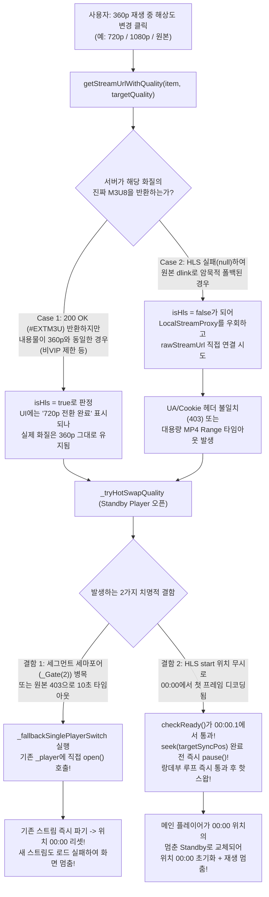

# 바이두(Baidu) & 테라박스(TeraBox) 해상도 변경 오류 및 재생 멈춤/위치 초기화 원인 분석 보고서

## 1. 증상 요약 (User-Reported Symptoms)

바이두(Baidu Netdisk) 및 테라박스(TeraBox) 미디어 재생 시 초기 `360p` 스트리밍은 정상 작동하지만, 재생 도중 다른 해상도(`480p`, `720p`, `1080p`, `원본`)로 변경을 시도할 때 다음과 같은 **3가지 복합 증상**이 발생합니다.

1. **현상 A (무반응)**: 해상도를 선택해도 한동안 아무런 변화가 일어나지 않거나 전환이 불발됨.
2. **현상 B (무늬만 해상도 변경 - 화질 동일)**: 화면 하단에 `"화질 전환 완료: 720p"` (또는 `"선택한 화질을 지원하지 않아 원본으로 재생됩니다"`) 배너가 출력되고 상단 HD 아이콘 뱃지도 바뀌지만, **실제 영상 화질은 여전히 `360p` 그대로 유지됨.**
3. **현상 C (재생 위치 초기화 및 멈춤)**: 해상도 변경을 시작하면 **재생 위치(Seek Bar)가 `00:00`(처음)으로 돌아가고 플레이어가 멈춰버림.**

---

## 2. 현상별 근본 원인 정밀 분석 (Root Cause Analysis)

현재 [`player_screen.dart`](file:///D:/My%20Documents/AI/cloud_media_player/lib/ui/screens/player_screen.dart), [`local_stream_proxy.dart`](file:///D:/My%20Documents/AI/cloud_media_player/lib/services/local_stream_proxy.dart), [`baidu_service.dart`](file:///D:/My%20Documents/AI/cloud_media_player/lib/services/baidu_service.dart), [`terabox_service.dart`](file:///D:/My%20Documents/AI/cloud_media_player/lib/services/terabox_service.dart)의 코드 흐름을 추적한 결과, 아래 **5가지 구조적 원인**이 맞물려 위 증상들을 일으키고 있습니다.

---

### 원인 1. [`LocalStreamProxy`] 글로벌 세마포어(`_Gate(2)`)와 듀얼 플레이어 간의 데드락/기아 현상 (무반응 & 10초 타임아웃의 주원인)

* **관련 코드**: [`lib/services/local_stream_proxy.dart#L22`](file:///D:/My%20Documents/AI/cloud_media_player/lib/services/local_stream_proxy.dart#L22), [`#L314-L363`](file:///D:/My%20Documents/AI/cloud_media_player/lib/services/local_stream_proxy.dart#L314-L363)
  ```dart
  final http.Client _segmentClient = http.Client();
  final _Gate _segmentGate = _Gate(2); // 프록시 전체에서 동시 세그먼트 연결을 최대 2개로 제한!
  ```
* **발생 메커니즘**:
  1. 초기 `360p` 재생 시 [`_applyPlayerPlatformProperties()`](file:///D:/My%20Documents/AI/cloud_media_player/lib/ui/screens/player_screen.dart#L158-L162)에 설정된 `demuxer-readahead-secs: 30`(30초 선행 버퍼링)과 `64MB` 버퍼 설정에 의해, **기존 플레이어(`_player`)는 쉬지 않고 HLS `.ts` 세그먼트를 연속으로 요청**하며 `_segmentGate(2)`의 슬롯을 점유합니다.
  2. 또한 재생 시작 13초 뒤 실행되는 [`prefetchQualities()`](file:///D:/My%20Documents/AI/cloud_media_player/lib/ui/screens/player_screen.dart#L454-L457)가 백그라운드에서 `480p`, `720p`, `1080p` M3U8 엔드포인트를 순차 조회하며 네트워크/쿠키 세션을 점유합니다.
  3. 이 상태에서 사용자가 해상도 변경을 누르면 [`_tryHotSwapQuality()`](file:///D:/My%20Documents/AI/cloud_media_player/lib/ui/screens/player_screen.dart#L2376-L2443)가 **보조 플레이어(`_standbyPlayer`)**를 생성하여 새로운 프록시 세션으로 오픈합니다.
  4. 이때 `_standbyPlayer`의 `.ts` 세그먼트 요청은 **기존 `_player`가 잡고 있는 `_segmentGate(2)` 세마포어 대기열(`_waiters`) 뒤에 갇히게 됩니다.**
  5. 바이두/테라박스 무료 계정의 대역폭 제한으로 인해 기존 360p 세그먼트 1~2개 다운로드가 수 초씩 걸리면, `_standbyPlayer`는 **10초 타임아웃([`player_screen.dart#L2435`](file:///D:/My%20Documents/AI/cloud_media_player/lib/ui/screens/player_screen.dart#L2435)) 동안 첫 프레임을 디코딩하지 못해 무조건 실패(`isReady = false`)**합니다.
  6. 이로 인해 사용자는 **약 10초 동안 아무 반응이 없는 것처럼 느끼게 되며**, 10초 후에는 강제로 단일 플레이어 폴백([`_fallbackSinglePlayerSwitch()`](file:///D:/My%20Documents/AI/cloud_media_player/lib/ui/screens/player_screen.dart#L2602))으로 넘어갑니다.

---

### 원인 2. [`BaiduService` / `TeraBoxService`] 서버 측 트랜스코딩 해상도 강제 다운그레이드 및 M3U8 내용 미검증 (배너는 720p인데 실제 화질은 360p인 원인)

* **관련 코드**:
  * [`lib/services/baidu_service.dart#L581-L637`](file:///D:/My%20Documents/AI/cloud_media_player/lib/services/baidu_service.dart#L581-L637) (`_fetchHlsStreamUrl`)
  * [`lib/services/terabox_service.dart#L451-L545`](file:///D:/My%20Documents/AI/cloud_media_player/lib/services/terabox_service.dart#L451-L545) (`_fetchHlsStreamUrl`)
* **발생 메커니즘**:
  1. **바이두/테라박스 서버의 비VIP(무료) 계정 정책 및 원본 해상도 제한**:
     * 바이두 PCS API(`method=streaming&type=M3U8_AUTO_720` 또는 `1080`)와 테라박스 `/api/streaming?type=M3U8_AUTO_720`은 요청 파라미터로 `720`이나 `1080`을 보내더라도,
       * **(Case 1)** 계정 권한(비VIP) 제한이나 서버 트랜스코딩 정책에 의해 **내부적으로 `360p`(`640x360` 또는 `854x480` 미만) 세그먼트가 담긴 `#EXTM3U` 플레이리스트를 그대로 `200 OK`로 반환**하거나,
       * **(Case 2)** `errno` JSON(예: 바이두 `errno: -6`, `errno: 31066`, 테라박스 `errno: 110` 등)을 반환하여 `_fetchHlsStreamUrl`이 `null`을 리턴합니다.
  2. **요청 URL 문자열만으로 화질 성공 여부를 판별하는 로직 결함**:
     * `_fetchHlsStreamUrl`은 응답 본문에 `#EXTM3U` 문자열만 포함되어 있으면 **실제 M3U8 내부 세그먼트의 해상도나 비트레이트가 360p와 동일한지 전혀 확인하지 않고** `streamUri.toString()`(파라미터에 `type=M3U8_AUTO_720`이 적힌 URL)을 그대로 반환합니다.
     * [`_switchQuality()`](file:///D:/My%20Documents/AI/cloud_media_player/lib/ui/screens/player_screen.dart#L2325-L2329)는 URL에 `api/streaming` 또는 `method=streaming`이 들어있으므로 `isHls = true`, `isFallbackToOriginal = false`로 판정하고 UI 상태를 `_currentQuality = targetQuality`(720p)로 바꾼 뒤 **`"화질 전환 완료: 720p"` 배너를 띄웁니다.**
     * 특히 [`player_screen.dart#L2567-L2571`](file:///D:/My%20Documents/AI/cloud_media_player/lib/ui/screens/player_screen.dart#L2567-L2571)에서 `actualW x actualH`를 찍어주려 하지만, **단일 플레이어 폴백(`_fallbackSinglePlayerSwitch`)으로 넘어간 경우에는 아예 완료 배너조차 없거나 디코딩 전에 상태만 바뀌어** 사용자는 화질이 바뀐 줄 알지만 실제로는 360p 세그먼트를 그대로 보고 있게 됩니다.

---

### 원인 3. [`PlayerScreen`] 480p/720p/1080p HLS 실패 시 암묵적 '원본(dlink)' 폴백 및 `LocalStreamProxy` 우회 버그 (위치 00:00 초기화 & 재생 멈춤의 핵심 원인 1)

* **관련 코드**:
  * [`lib/services/baidu_service.dart#L395-L408`](file:///D:/My%20Documents/AI/cloud_media_player/lib/services/baidu_service.dart#L395-L408)
  * [`lib/services/terabox_service.dart#L337-L350`](file:///D:/My%20Documents/AI/cloud_media_player/lib/services/terabox_service.dart#L337-L350)
  * [`lib/ui/screens/player_screen.dart#L2325-L2334`](file:///D:/My%20Documents/AI/cloud_media_player/lib/ui/screens/player_screen.dart#L2325-L2334)
* **발생 메커니즘**:
  1. 사용자가 `720p`나 `1080p`(또는 `원본`)를 선택했을 때, 서버에서 해당 고해상도 HLS(`M3U8_AUTO_720` / `1080`)를 지원하지 않아 `_fetchHlsStreamUrl()`이 `null`을 반환하면, [`_resolveStreamUrl()`](file:///D:/My%20Documents/AI/cloud_media_player/lib/services/baidu_service.dart#L407)은 **자동으로 2단계인 원본 직링크(`dlink` / `locatedownload`)를 반환**합니다.
  2. 이 `dlink` URL에는 `.m3u8`이나 `streaming` 문자열이 없으므로, [`_switchQuality()`](file:///D:/My%20Documents/AI/cloud_media_player/lib/ui/screens/player_screen.dart#L2325-L2334)에서 **`isHls = false`**가 됩니다:
     ```dart
     final isHls = rawStreamUrl.contains('.m3u8') ||
         rawStreamUrl.contains('api/streaming') ||
         rawStreamUrl.contains('method=streaming');
     // isHls가 false이면 LocalStreamProxy를 쓰지 않고 rawStreamUrl을 직접 사용!
     final playUrl = ((isBaiduOrTeraBox && isHls) || isNaver || isMega)
         ? LocalStreamProxy.instance.registerStream(widget.service, widget.item, quality: targetQuality)
         : rawStreamUrl;
     ```
  3. **치명적 문제**: 바이두와 테라박스의 원본 `dlink`(CDN URL)는 다음과 같은 특성이 있습니다:
     * **단일 플레이어/보조 플레이어의 헤더 충돌**: `_applyPlayerPlatformProperties`에서 설정한 `demuxer-lavf-o: headers=...`와 `Media(playUrl, httpHeaders: headers)`가 동시에 전달되면서 `libmpv`의 FFmpeg HTTP 컨텍스트에서 `Cookie` 또는 `User-Agent`(`LogStatistic` vs `Mozilla/5.0...`)가 어긋나거나 302 리다이렉트 시 헤더가 유실됩니다.
     * 특히 [`BaiduService._resolveStreamUrl()`](file:///D:/My%20Documents/AI/cloud_media_player/lib/services/baidu_service.dart#L489-L495)은 `PCS locatedownload`(`pcsUserAgent = 'LogStatistic'` 전용)로 얻은 URL을 **`defaultUserAgent`(`Mozilla/5.0...`)로 302 사전 해석(Pre-resolve)**하고, 반대로 `getStreamHeaders()`는 `LogStatistic`을 반환하여 **서명된 CDN URL의 UA 검증 실패(403 Forbidden)**를 유발합니다!
     * 또한 대용량 원본 파일(MKV/MP4)을 무료 계정 속도 제한(수십~수백 KB/s) 환경에서 `start: currentPos`(영상 중간 위치)로 열면, `libmpv`는 파일 끝부분의 `moov` 아톰이나 Cues 인덱스를 읽기 위해 다중 HTTP Range 요청을 보내다가 **서버로부터 연결 거부(403/502) 또는 타임아웃**을 맞습니다.

---

### 원인 4. [`_fallbackSinglePlayerSwitch` & `_tryHotSwapQuality`] 전환 실패/폴백 시 재생 위치 `00:00` 초기화 및 플레이어 정지 메커니즘 (위치 00:00 초기화 & 재생 멈춤의 핵심 원인 2)

사용자가 *"해상도 변경을 시작하면 플레이 위치가 처음으로 돌아가고 플레이가 멈춰버린다"*고 겪은 현상은 코드상 아래 **2가지 경로**에서 정확히 발생합니다.

#### 경로 A: `_fallbackSinglePlayerSwitch()` 진입 시 기존 스트림 파기 및 `position` 0 초기화
* **관련 코드**: [`lib/ui/screens/player_screen.dart#L2602-L2686`](file:///D:/My%20Documents/AI/cloud_media_player/lib/ui/screens/player_screen.dart#L2602-L2686)
  ```dart
  final currentPos = _player.state.position;
  ...
  await _player.open(
    Media(
      playUrl,
      httpHeaders: headers.isNotEmpty ? headers : null,
      start: currentPos,
    ),
    play: true,
  );
  ```
* **발생 메커니즘**:
  1. 앞서 설명한 원인 1~3으로 인해 듀얼 플레이어 핫스왑(`_tryHotSwapQuality`)이 실패(`return false`)하면, [`_fallbackSinglePlayerSwitch()`](file:///D:/My%20Documents/AI/cloud_media_player/lib/ui/screens/player_screen.dart#L2352)가 실행됩니다.
  2. `_fallbackSinglePlayerSwitch()`는 **현재 잘 재생되고 있던 메인 `_player`에서 즉시 `_player.open(Media(playUrl, start: currentPos))`를 호출**합니다.
  3. `libmpv`(`media_kit`)는 `_player.open()`이 호출되는 순간 기존 360p 스트림을 닫고 내부 상태를 초기화하므로, **`_player.state.position`이 즉시 `Duration.zero`(`00:00`)로 리셋**되고 `playing` 상태도 멈춥니다!
  4. 하단 Seek Bar(`StreamBuilder<Duration>(stream: _player.stream.position)`)는 `_player.state.position`을 그대로 바라보고 있으므로 **슬라이더와 시간 표시가 즉시 `00:00`으로 돌아갑니다.**
  5. 동시에 `_freezeFrameBytes`(캡처한 정지 화면)가 화면을 덮은 상태에서 새 스트림(`playUrl`) 연결이 실패하거나(원본 403 에러 등) HLS `start: currentPos` 탐색이 먹통이 되면, **3초 뒤 타이머([`2658행`](file:///D:/My%20Documents/AI/cloud_media_player/lib/ui/screens/player_screen.dart#L2658))가 `_freezeFrameBytes`만 지우고 `_currentQuality = targetQuality`로 바꿔버립니다.**
  6. 결과적으로 **UI 상으로는 해상도가 바뀐 것처럼 나오지만, 재생 위치는 `00:00`으로 돌아가 있고 영상은 멈춰버리는(Dead state) 현상**이 발생합니다!
  7. 더 심각한 것은, 이 상태에서 5초마다 도는 `_positionSaveTimer`([`303행`](file:///D:/My%20Documents/AI/cloud_media_player/lib/ui/screens/player_screen.dart#L303))나 화면 종료 시점의 `_saveCurrentPosition()`이 초기화된 위치를 덮어쓸 위험까지 존재합니다.

#### 경로 B: HLS 스트림에서 `Media(start: ...)` + `hr-seek: yes` 조합의 탐색 실패 및 0초 리셋
* **관련 코드**: [`lib/ui/screens/player_screen.dart#L170-L171`](file:///D:/My%20Documents/AI/cloud_media_player/lib/ui/screens/player_screen.dart#L170-L171), [`#L2410-L2417`](file:///D:/My%20Documents/AI/cloud_media_player/lib/ui/screens/player_screen.dart#L2410-L2417), [`#L2467-L2511`](file:///D:/My%20Documents/AI/cloud_media_player/lib/ui/screens/player_screen.dart#L2467-L2511)
* **발생 메커니즘**:
  1. 바이두/테라박스의 HLS(`M3U8`) 스트림을 로컬 프록시(`http://127.0.0.1:port/stream?session=...`)로 열 때, `Media(playUrl, start: targetStart)`를 전달하면 `libmpv`의 HLS 디먹서는 플레이리스트 파싱 직후 해당 시간대의 세그먼트로 점프를 시도합니다.
  2. 하지만 일부 HLS 스트림이나 프록시 재작성 플레이리스트에서는 초기 오픈 시 `start` 옵션이 무시되어 **`00:00`(첫 번째 세그먼트, `standby.state.position = 0.1초` 등)부터 디코딩이 시작**되는 경우가 자주 발생합니다.
  3. 이때 [`checkReady()`(2424~2431행)](file:///D:/My%20Documents/AI/cloud_media_player/lib/ui/screens/player_screen.dart#L2424-L2431) 조건을 보면:
     ```dart
     final hasWidth = standby.state.width != null && standby.state.width! > 0;
     final notBuffering = !standby.state.buffering;
     final posAdvancing = standby.state.position > Duration.zero; // <-- 0.01초만 되어도 true!
     if (hasWidth && notBuffering && posAdvancing) {
       readyCompleter.complete(true);
     }
     ```
     * `standby`가 목표 위치(예: 15분 00초)가 아니라 **`00:00.1`(맨 처음)에서 첫 프레임을 디코딩했는데도 `posAdvancing`이 `true`가 되어 `readyCompleter`가 즉시 완료**됩니다!
  4. 그 직후 [`2474~2486행`](file:///D:/My%20Documents/AI/cloud_media_player/lib/ui/screens/player_screen.dart#L2474-L2486)에서 `diffMs < 80`이므로 `await standby.seek(targetSyncPos)`를 호출하고 `buffering.firstWhere((b) => !b)`를 기다리는데:
     * `standby.seek()` 호출 직후 `libmpv`가 아직 `buffering = true`로 전환하기도 전에 `standby.stream.buffering`의 현재 값(`false`)이 즉시 평가되어 **`seek`가 완료되기도 전에 통과**해 버립니다!
     * 그리고 곧바로 `await standby.pause()`를 호출해 버리므로, **`standby`는 `00:00` 위치에서 일시정지(`pause`)되거나 `seek` 도중 디코더가 멈춘 상태**가 됩니다.
  5. 이어서 랑데부 루프([`2501행`](file:///D:/My%20Documents/AI/cloud_media_player/lib/ui/screens/player_screen.dart#L2501))는 `parkedPos`(여전히 `00:00` 근처)보다 `currentLive`(예: `15:00`)가 크므로 **단 1ms도 기다리지 않고 즉시 `break`로 탈출**하여 핫스왑을 단행합니다!
  6. 핫스왑 결과:
     * 메인 플레이어(`_player`)가 아직 `seek` 중이거나 `00:00`에 멈춰있는 `standby`로 교체되면서 **재생 위치가 `00:00`(처음)으로 돌아가 버리고**,
     * `standby`가 `pause()` 직후 `seek` 플러시 상태에서 꼬여 **재생이 그대로 멈춰버립니다!**

---

### 원인 5. [`_switchQuality`] 프록시 등록 시 `initialUrl` 누락으로 인한 중복 API 호출 지연

* **관련 코드**: [`lib/ui/screens/player_screen.dart#L2331-L2333`](file:///D:/My%20Documents/AI/cloud_media_player/lib/ui/screens/player_screen.dart#L2331-L2333)
  ```dart
  // _initAndPlay(436행)에서는 initialUrl: rawStreamUrl을 전달하지만,
  // _switchQuality(2332행)에서는 initialUrl을 전달하지 않음!
  final playUrl = ((isBaiduOrTeraBox && isHls) || isNaver || isMega)
      ? LocalStreamProxy.instance.registerStream(widget.service, widget.item, quality: targetQuality)
      : rawStreamUrl;
  ```
* **발생 메커니즘**:
  * `_switchQuality`에서 이미 `rawStreamUrl`을 구해놓고도 `registerStream`에 `initialUrl: rawStreamUrl`을 넘기지 않아, `LocalStreamProxy`가 요청을 받을 때 다시 `refreshTokensIfNeeded()`와 `getStreamUrlWithQuality()`를 호출합니다.

---

## 3. 전체 문제 발생 흐름 요약 다이어그램



---

## 4. 해결을 위한 핵심 개선 방향 (Action Plan Summary)

1. **`_fallbackSinglePlayerSwitch`(인플레이스 강제 재오픈) 제거 및 안전한 전환 취소(Rollback) 도입**:
   * 백그라운드 `_standbyPlayer`에서 새 해상도 스트림을 여는 데 실패(10초 타임아웃, 403 에러 등)하면, **절대로 현재 잘 재생 중인 `_player`에 덮어써서(`_player.open`) 재생을 멈추거나 `00:00`으로 초기화하지 않고**, `_standbyPlayer`만 조용히 파기한 뒤 **기존 `360p` 재생을 끊김 없이 그대로 유지**하면서 `"해당 화질 스트림을 불러올 수 없어 현재 화질을 유지합니다"` 배너를 띄워야 합니다.
2. **`_tryHotSwapQuality`의 `checkReady()` 및 `seek` 완료 판별 조건 강화 (`00:00` 리셋 방지)**:
   * `checkReady()`에서 단순히 `standby.state.position > Duration.zero`만 보지 않고, **`targetStart` 근처(예: `(standby.state.position - targetStart).abs() < 15초`)에 실제로 도달했는지 확인**해야 합니다.
   * 만약 `00:00` 근처에서 시작되었다면 즉시 `await standby.seek(targetStart)`를 수행하고, 단순히 `buffering == false`가 아니라 **`standby.state.position >= targetStart - 2초`가 될 때까지 실제로 대기**한 후에만 핫스왑을 허용해야 합니다.
   * 또한 핫스왑 직후 `_ensureAutoPlay()`가 새 `_player`에도 바인딩되도록 하여 스왑 후 일시정지 상태로 멈추는 현상을 방지해야 합니다.
3. **`LocalStreamProxy` 세마포어 분리 및 `initialUrl` 전달**:
   * `_Gate(2)`를 프록시 전역이 아니라 **세션(`_ActiveStream`) 단위**로 분리하거나 동시 허용치를 늘려, 기존 360p 플레이어의 선행 버퍼링이 새 해상도 `_standbyPlayer`의 초기 세그먼트 로드를 가로막지 않도록 해야 합니다.
   * `_switchQuality`에서 `registerStream` 호출 시 `initialUrl: rawStreamUrl`을 전달하여 중복 API 호출을 제거해야 합니다.
4. **바이두/테라박스 실제 해상도 검증 및 무음 폴백 방지**:
   * 사용자가 `480p`/`720p`/`1080p`를 명시적으로 선택했을 때 `_fetchHlsStreamUrl()`이 실패하면, 사용자 몰래 느리고 불안정한 `원본(dlink)`으로 자동 폴백하지 않도록 분리하거나,
   * 핫스왑 직전 `standby.state.width`와 `standby.state.height`를 기존 `_player.state.width/height`와 비교하여 서버가 동일한 `360p`(`640x360`) 스트림을 내려준 경우 `"서버에서 고화질 변환을 지원하지 않는 영상입니다 (현재 화질: 640x360)"`라고 명확히 안내해야 합니다.
   * 또한 `BaiduService`에서 `PCS locatedownload` URL의 302 사전 해석 시 `defaultUserAgent` 대신 `pcsUserAgent`(`LogStatistic`)를 사용하여 UA 불일치로 인한 403 에러를 해결해야 합니다.
