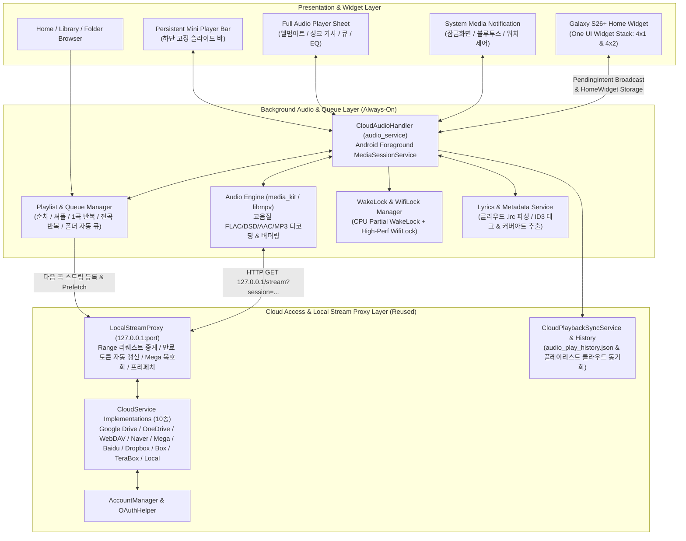
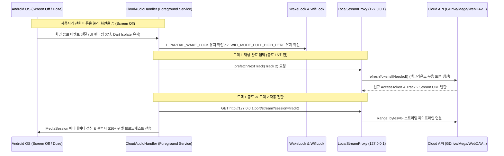

# Cloud Audio Player 아키텍처 설계서 (Architecture & Design Specification)

> [!IMPORTANT]
> 본 문서는 기존 `cloud_media_player`의 멀티 클라우드 액세스 및 스트리밍 프록시 인프라를 재사용하여, **화면이 꺼진 백그라운드/Doze 모드 스트리밍**과 **갤럭시 S26+ (One UI 7/8) 위젯 스택(Widget Stack)** 환경에 최적화된 **`cloud_audio_player`**의 전체 시스템 구조를 정의합니다.

---

## 1. 프로젝트 개요 및 핵심 설계 목표

### 1.1 프로젝트 경로 및 기반
- **대상 경로**: `D:\My Documents\AI\cloud_audio_player`
- **베이스 코드**: `D:\My Documents\AI\cloud_media_player`의 클라우드 계층 및 인증/동기화 엔진 이식
- **타겟 플랫폼**: Android (특히 **Galaxy S26+ / One UI 위젯 스택 & 백그라운드 서비스** 완벽 대응) 및 Windows 데스크톱

### 1.2 핵심 전환 포인트 (Video $\rightarrow$ Audio)
1. **클라우드 레이어 100% 재사용**: Google Drive, OneDrive, WebDAV, Box, Dropbox, TeraBox, Baidu, Naver MYBOX, Mega, Local Storage 등 10종 스토리지 인터페이스 그대로 계승.
2. **화면 중심(Screen-bound)에서 서비스 중심(Service-bound)으로 구조 전환**:
   - 기존 비디오 플레이어는 `PlayerScreen` 위젯 생명주기에 `Player` 인스턴스가 종속되어 화면 이탈/종료 시 재생이 멈춤.
   - 오디오 플레이어는 **전역 싱글톤 `AudioPlayerService` + Android Foreground `MediaSessionService`(`audio_service`)** 구조로 분리하여, 화면이 꺼지거나 앱 UI가 내려가도 끊김 없이 백그라운드에서 다음 곡 자동 넘어감(Gapless/Queue) 및 토큰 자동 갱신 수행.
3. **갤럭시 S26+ 홈 화면 & 위젯 스택(Widget Stack) 최적화**:
   - One UI 위젯 스택의 표준 규격인 **4x1 (소형 제어형)** 및 **4x2 (중형 커버+큐 확장형)** 사이즈와 곡률(`system_app_widget_background_radius`), 다크/라이트/동적 컬러 테마 대응.
   - 앱을 열지 않고도 위젯에서 즉시 재생/일시정지, 이전/다음 곡, 셔플/반복 제어 가능.

---

## 2. 전체 시스템 아키텍처



---

## 3. 기존 `cloud_media_player` 모듈 재사용 및 확장 명세

### 3.1 100% 그대로 재사용하는 모듈 (`lib/services/` & `lib/utils/`)
| 분류 | 대상 파일 | 역할 및 재사용 방식 |
| :--- | :--- | :--- |
| **클라우드 인터페이스** | `cloud_service_interface.dart`, `cloud_account.dart`, `account_manager.dart` | 계정 관리, 토큰 만료 감지 및 갱신 콜백 구조 그대로 유지 |
| **클라우드 구현체 (10종)** | `google_drive_service.dart`, `onedrive_service.dart`, `webdav_service.dart`, `naver_box_service.dart`, `mega_service.dart`, `baidu_service.dart`, `terabox_service.dart`, `dropbox_service.dart`, `box_service.dart`, `local_disk_service.dart` | 폴더 탐색(`listItems`), 스트림 URL 획득(`getStreamUrl`), 인증 헤더(`getStreamHeaders`) 수정 없이 재사용 |
| **보안 및 유틸리티** | `google_auth_manager.dart`, `oauth_helper.dart`, `mega_crypto_utils.dart`, `battery_utils.dart`, `permission_utils.dart`, `folder_shortcut_manager.dart` | OAuth 인증, Mega AES-CTR 실시간 복호화, 배터리 최적화 예외 요청 등 그대로 재사용 |

### 3.2 오디오 전용으로 수정/확장하는 모듈
1. **`models/media_item.dart`**:
   - **`isAudio` 게터(Getter) 추가**:
     - 지원 확장자: `.mp3`, `.flac`, `.wav`, `.m4a`, `.aac`, `.ogg`, `.opus`, `.wma`, `.alac`, `.ape`, `.dsf`, `.dff`, `.mka`, `.aiff`
     - MIME 타입 판별: `mimeType != null && mimeType!.startsWith('audio/')`
   - **`isLyrics` 게터(Getter) 추가**:
     - `.lrc`, `.txt`, `.srt` (오디오 파일과 동일 파일명을 가진 가사 파일 자동 매칭용)
   - **`isCoverArt` 게터(Getter) 추가**:
     - 폴더 내 `cover.jpg`, `folder.jpg`, `front.png` 또는 동일 파일명 이미지 매칭용
   - **오디오 메타데이터 필드 확장**: `artist`, `album`, `trackNumber`, `bitrate`, `sampleRate` (선택적 파싱/캐싱)
2. **`services/local_stream_proxy.dart` (오디오 스트리밍 특화 개선)**:
   - 기존 비디오 스트리밍 및 Mega 복호화, HLS 리라이트 기능 유지.
   - **Next-Track Prefetch (다음 곡 선행 세션 준비)**: 현재 곡 재생이 80%를 넘어가거나 종료 20초 전일 때, 큐(Queue)의 다음 곡에 대한 클라우드 `getStreamUrl()` 및 토큰 갱신을 미리 수행하여 **화면이 꺼진 상태에서 곡이 바뀔 때 네트워크 지연으로 끊기는 현상 방지**.
   - **In-Memory Audio Chunk Ring-Buffer (선택적 캐시)**: 오디오 파일은 비디오 대비 용량이 작으므로(보통 5~40MB), ID3 태그 파싱을 위한 파일 앞/뒤 헤더 요청 시 중복 네트워크 호출을 막는 헤더/청크 캐시 적용.
3. **`services/playback_history_service.dart` & `cloud_playback_sync_service.dart`**:
   - 동기화 파일명을 `audio_play_history.json` (및 `audio_playlists.json`)으로 분리하여 기존 비디오 플레이어 데이터와 충돌하지 않도록 구성.
   - 긴 오디오북/팟캐스트/DJ 믹스셋을 위한 **트랙별 이어듣기(Resume)**와 일반 음악 감상을 위한 **마지막 재생 큐(Queue) & 트랙 위치 복원** 모드 동시 지원.

---

## 4. 화면 꺼짐(Screen-Off) 백그라운드 오디오 스트리밍 아키텍처

스마트폰 화면이 꺼진 상태에서도 수 시간 동안 클라우드 오디오 스트리밍이 끊기지 않으려면, Android OS의 **Doze 모드(절전)**, **네트워크 슬립**, **클라우드 토큰 만료**, **백그라운드 프로세스 킬** 등 4가지 장벽을 모두 넘어야 합니다.



### 4.1 Android Foreground Service & MediaSession 구성
- **패키지 조합**: `audio_service` + `audio_session` + `media_kit` (`libmpv` 오디오 전용 모드 `VideoController` 미생성으로 GPU/메모리 점유 최소화).
- **`AndroidManifest.xml` 필수 권한 및 서비스 선언**:
  - `android.permission.FOREGROUND_SERVICE`
  - `android.permission.FOREGROUND_SERVICE_MEDIA_PLAYBACK` (Android 14 / API 34+ 필수, 갤럭시 S26+의 Android 16/17 환경 핵심 요구사항)
  - `android.permission.WAKE_LOCK`
  - `android.permission.ACCESS_WIFI_STATE` / `CHANGE_WIFI_STATE`
  - `AudioServiceActivity` 및 `MediaButtonReceiver` 등록으로 블루투스 이어폰(갤럭시 버즈 등), 안드로이드 오토, 갤럭시 워치 미디어 컨트롤러와 100% 연동.

### 4.2 CPU WakeLock + High-Performance Wi-Fi Lock + 배터리 최적화 예외
1. **CPU Partial WakeLock (`PowerManager.PARTIAL_WAKE_LOCK`)**:
   - 재생 중(`playing == true`)일 때 CPU가 슬립 상태로 빠지지 않도록 유지하여 Dart VM의 `LocalStreamProxy` 소켓 서버(`127.0.0.1`)가 죽지 않게 보호합니다.
2. **Wi-Fi Lock (`WifiManager.WIFI_MODE_FULL_HIGH_PERF` / `WIFI_MODE_FULL_LOW_LATENCY`)**:
   - 화면이 꺼진 후 Wi-Fi 칩셋이 절전 모드로 들어가 패킷 드랍이 발생하는 것을 방지하기 위해 `MainActivity.kt`의 네이티브 채널을 통해 Wi-Fi Lock을 함께 획득합니다.
3. **One UI 절전 예외 가이드 (`BatteryUtils` 재사용)**:
   - 삼성 One UI의 "백그라운드 사용 제한(절전/초절전 앱)"에 의해 앱이 강제 종료되지 않도록, 최초 실행 또는 설정 화면에서 `requestIgnoreBatteryOptimizations()`(배터리 사용량 최적화 제외: '제한 없음')를 원클릭으로 설정할 수 있게 지원합니다.

### 4.3 화면 꺼짐 중 무음 토큰 갱신 (Silent Token Refresh)
- Google Drive나 OneDrive, Baidu 등의 스트리밍 URL 및 Access Token은 보통 1시간 뒤 만료됩니다.
- 화면이 꺼진 상태에서 플레이리스트를 2시간 이상 재생할 때, `LocalStreamProxy`가 각 곡의 스트림 요청 시점마다 `service.refreshTokensIfNeeded()`를 호출합니다.
- 이때 UI 팝업 없이 저장된 `refreshToken`과 HTTP 클라이언트를 통해 백그라운드에서 토큰을 갱신하고 `AccountManager`에 자동 저장합니다.

---

## 5. 갤럭시 S26+ 맞춤형 위젯 및 위젯 스택(Widget Stack) 설계

갤럭시 S26+ (One UI 7 / One UI 8 기반) 홈 화면에서 가장 많이 활용되는 기능은 여러 위젯을 겹쳐 놓고 좌우로 스와이프해 전환하는 **위젯 스택(Widget Stack, 스마트 위젯)**입니다.

### 5.1 갤럭시 S26+ 위젯 스택(Widget Stack) 고려사항
1. **규격화된 그리드 사이즈 매칭**:
   - One UI 위젯 스택에 다른 삼성 기본 위젯(날씨, 캘린더, 배터리, 스마트 추천 등)과 함께 묶이려면 **4x1 (가로형 슬림)** 및 **4x2 (표준 스택형)** 규격을 정확히 지원해야 합니다.
   - `targetCellWidth="4"`, `targetCellHeight="1"` (소형) 및 `targetCellWidth="4"`, `targetCellHeight="2"` (중형, 기본 권장 스택 사이즈) 두 가지 Provider를 제공합니다.
2. **One UI 곡률 및 여백 가이드 준수**:
   - 갤럭시 S26+의 위젯 스택 컨테이너는 모서리 곡률이 크게 들어가며(`@android:dimen/system_app_widget_background_radius`, 약 `22dp~26dp`), 스택 내부에서 위젯이 잘리지 않도록 외곽 패딩과 클리핑(`clipToOutline="true"`)을 맞춥니다.
3. **스와이프 제스처 충돌 방지 (핵심 UX 포인트)**:
   - 위젯 스택에서는 사용자가 **좌/우 스와이프**로 다른 위젯으로 전환합니다.
   - 따라서 위젯 내부에 드래그 가능한 `SeekBar`(탐색 바)를 넣으면 위젯 스택의 좌우 스와이프 제스처와 충돌하여 오작동이 발생합니다.
   - **해결책**: 위젯 내부의 진행률 표시줄은 터치 드래그가 없는 `ProgressBar`(읽기 전용)로 배치하고, 모든 조작은 명확한 **탭 버튼(`ImageButton` PendingIntent)**으로 구성합니다.

### 5.2 위젯 레이아웃 구성 (2종 제공)

#### A. 4x2 표준 스택 위젯 (`CloudAudioWidgetMedium` - 위젯 스택 최적화)
```text
+-------------------------------------------------------------------+
|  +-----------+  [Cloud Icon] Google Drive • FLAC                  |
|  |           |  노래 제목 (Title - 1줄 말줄임, Bold)              |
|  | Album Art |  아티스트 / 폴더명 (Artist / Folder - 1줄)         |
|  |  (80x80)  |                                                    |
|  |  Rounded  |  [=================>------------] 02:14 / 04:35    |
|  +-----------+                                                    |
|                 [ 🔀 ]    [ ⏮ ]    [ ⏸/▶ ]    [ ⏭ ]    [ 🔁 ]   |
+-------------------------------------------------------------------+
```
- **좌측**: 앨범 커버 아트 (없을 경우 클라우드 서비스 로고 배지가 포함된 세련된 바이닐/음표 그래픽 표시)
- **우측 상단**: 현재 스트리밍 중인 클라우드 종류 배지 + 곡 제목 + 아티스트(또는 부모 폴더명)
- **우측 중단**: 현재 곡 진행률 바 (`ProgressBar`)
- **우측 하단**: 셔플 토글, 이전 곡, 재생/일시정지(강조 원형 버튼), 다음 곡, 반복 모드 토글

#### B. 4x1 컴팩트 스택 위젯 (`CloudAudioWidgetSmall`)
```text
+-------------------------------------------------------------------+
| [Album Art]  노래 제목 (Title)              [ ⏮ ]  [ ⏸/▶ ]  [ ⏭ ] |
|   (48x48)    아티스트 • Cloud Name                                |
| [===========================>-----------------------------------] |
+-------------------------------------------------------------------+
```

### 5.3 위젯 $\leftrightarrow$ 백그라운드 서비스 양방향 통신 구조
- **상태 업데이트 (App $\rightarrow$ Widget)**:
  - `home_widget` 패키지 및 네이티브 `AppWidgetProvider`(Kotlin) 사용.
  - 곡 변경, 재생/일시정지 상태 변경, 커버 아트 로드 완료 시 `SharedPreferences`에 상태(제목, 아티스트, 클라우드명, 재생여부, 로컬 캐시된 앨범아트 경로, 진행률)를 기록하고 `AppWidgetManager.updateAppWidget()` 호출.
  - **배터리 절약형 진행률 갱신**: 화면이 꺼져 있을 때는 위젯 업데이트 브로드캐스트를 멈추거나 트랙 변경 시에만 호출하고, 화면이 켜져 있을 때만 분 단위/상태 변경 시 갱신하여 S26+ 배터리 소모를 최소화합니다.
- **버튼 제어 (Widget $\rightarrow$ App Background Service)**:
  - 앱이 완전히 종료된(Cold Start) 상태이거나 화면이 잠긴 상태에서 사용자가 위젯의 `[ ▶ ]` 또는 `[ ⏭ ]` 버튼을 누르면, Activity(화면)를 띄우지 않고 `MediaButtonReceiver` / `HomeWidgetBackgroundIntent`를 통해 **백그라운드 `CloudAudioHandler` 서비스로 즉시 명령을 전달**하여 마지막 재생 큐(Queue)를 즉시 이어서 스트리밍합니다.

---

## 6. 앱 UI/UX 및 주요 기능 구성

기존 `cloud_media_player`의 직관적인 탐색 구조를 유지하면서 오디오 플레이어에 특화된 UX로 개편합니다.

1. **메인 홈 & 클라우드 브라우저 (`HomeScreen` / `BrowserScreen`)**:
   - 상단: 연결된 10종 클라우드 계정 및 빠른 폴더 바로가기(`FolderShortcut`), 최근 재생한 오디오/폴더 목록.
   - 폴더 진입 시: 오디오 파일(`.mp3`, `.flac`, `.m4a` 등)만 깔끔하게 필터링하여 표시하며, 우측 상단에 **`[폴더 전체 재생]`** 및 **`[셔플 재생]`** 플로팅 액션 버튼 제공.
2. **하단 고정 미니 플레이어 (`MiniPlayerBar`)**:
   - 어떤 폴더를 탐색하고 있든 화면 하단에 항상 떠 있는 미니 컨트롤 바.
   - 스와이프 업(Swipe Up) 또는 탭하면 전체 플레이어 시트로 부드럽게 확장.
3. **전체 오디오 플레이어 화면 (`AudioPlayerSheet` / `PlayerScreen`)**:
   - **커버 아트 뷰**: 내장 ID3 커버 아트 또는 같은 클라우드 폴더 내의 `cover.jpg`/`folder.jpg` 자동 감지 렌더링.
   - **실시간 싱크 가사 (`.lrc` & 내장 가사)**: 기존 자막 파서(`subtitle_utils.dart` 및 인코딩 자동 감지 `charset_converter`/`fast_gbk`)를 응용하여, 같은 폴더의 동명 `.lrc` 파일을 클라우드에서 자동 로드해 하이라이트 스크롤 가사로 표시.
   - **재생 큐(Queue) & 플레이리스트 드로어**: 현재 재생 목록 순서 변경(드래그 앤 드롭), 셔플, 1곡 반복, 전곡 반복, 클라우드 간 통합 플레이리스트 생성.
   - **오디오 편의 기능**:
     - **취침 예약 타이머 (Sleep Timer)**: 15분 / 30분 / 60분 / '현재 곡까지만 재생 후 종료' (밤에 화면 끄고 들을 때 필수).
     - **재생 속도 조절 (0.5x ~ 2.0x)** 및 **무음 구간 건너뛰기 / 북마크** (오디오북/강의 청취 대응).
     - **이퀄라이저 / 음장 프리셋**: `libmpv` 오디오 필터(`af`) 기반 베이스 부스트, 보컬 강조, 노멀라이저 지원.

---

## 7. 디렉터리 구조 설계 (`cloud_audio_player`)

```text
D:\My Documents\AI\cloud_audio_player\
├── android/
│   └── app/src/main/
│       ├── AndroidManifest.xml                  # ForegroundService(mediaPlayback), WakeLock, Widget Receiver 등록
│       ├── kotlin/.../MainActivity.kt           # Battery/WifiLock 채널 & AudioServiceActivity 상속
│       ├── kotlin/.../widget/
│       │   ├── CloudAudioWidgetSmall.kt         # S26+ 위젯 스택용 4x1 AppWidgetProvider
│       │   └── CloudAudioWidgetMedium.kt        # S26+ 위젯 스택용 4x2 AppWidgetProvider
│       └── res/
│           ├── layout/widget_audio_small.xml    # 4x1 RemoteViews 레이아웃
│           ├── layout/widget_audio_medium.xml   # 4x2 RemoteViews 레이아웃 (One UI 둥근 모서리 적용)
│           └── xml/
│               ├── widget_info_small.xml        # targetCellWidth=4, targetCellHeight=1
│               └── widget_info_medium.xml       # targetCellWidth=4, targetCellHeight=2
├── lib/
│   ├── main.dart                                # AudioService 초기화, LocalStreamProxy 기동, MultiProvider
│   ├── models/
│   │   ├── cloud_account.dart                   # [재사용] 10종 클라우드 계정 모델
│   │   ├── folder_shortcut.dart                 # [재사용] 폴더 바로가기 모델
│   │   ├── media_item.dart                      # [확장] isAudio, isLyrics, isCoverArt 및 오디오 메타데이터 추가
│   │   ├── audio_queue_item.dart                # [신규] 클라우드 계정 ID + MediaItem + 커버/가사 매핑 큐 아이템
│   │   ├── playlist_model.dart                  # [신규] 다중 클라우드 통합 플레이리스트 모델
│   │   └── lyrics_line.dart                     # [신규] 타임스탬프 기반 .lrc 싱크 가사 모델
│   ├── services/
│   │   ├── cloud_service_interface.dart         # [재사용] 클라우드 공통 추상 인터페이스
│   │   ├── account_manager.dart                 # [재사용] 클라우드 계정 매니저
│   │   ├── (10종 클라우드 서비스 파일들)         # [재사용] GDrive, OneDrive, WebDAV, Naver, Mega, Baidu 등
│   │   ├── local_stream_proxy.dart              # [확장] 백그라운드 세션 유지 + 다음 곡 URL Prefetch 추가
│   │   ├── audio_player_service.dart            # [신규] 전역 오디오 컨트롤러 & Queue/Shuffle/Repeat/SleepTimer 관리
│   │   ├── cloud_audio_handler.dart             # [신규] audio_service BaseAudioHandler 구현 (잠금화면/백그라운드 제어)
│   │   ├── widget_sync_service.dart             # [신규] S26+ 홈 위젯 데이터 푸시 및 위젯 클릭 인텐트 수신
│   │   ├── lyrics_service.dart                  # [신규] 클라우드 .lrc 자동 탐색 및 인코딩(UTF-8/EUC-KR/GBK) 파싱
│   │   ├── playback_history_service.dart        # [확장] 오디오 재생 기록 및 마지막 재생 큐(Queue) 상태 저장
│   │   └── cloud_playback_sync_service.dart     # [확장] audio_play_history.json 클라우드 간 동기화
│   ├── ui/
│   │   ├── screens/
│   │   │   ├── home_screen.dart                 # 클라우드 계정, 즐겨찾기 폴더, 플레이리스트, 최근 재생 탭
│   │   │   ├── browser_screen.dart              # 오디오 필터링 브라우저 (폴더 전체 재생 / 큐에 추가)
│   │   │   └── full_player_sheet.dart           # 풀스크린 오디오 플레이어 (앨범아트, 가사, 큐, 타이머)
│   │   └── widgets/
│   │       ├── mini_player_bar.dart             # 하단 고정 미니 플레이어 (언제든 제어 및 확장 가능)
│   │       ├── lyrics_view.dart                 # 실시간 싱크 가사 스크롤 위젯
│   │       ├── queue_bottom_sheet.dart          # 현재 재생목록 편집 시트
│   │       └── sleep_timer_dialog.dart          # 취침 예약 타이머 설정 다이얼로그
│   └── utils/
│       ├── battery_utils.dart                   # [확장] 절전 예외 요청 + 네이티브 High-Perf WifiLock 제어 추가
│       ├── mega_crypto_utils.dart               # [재사용] Mega 복호화 유틸리티
│       └── lrc_parser_utils.dart                # [신규] LRC 타임태그 파서 (기존 subtitle_utils 기반)
└── pubspec.yaml                                 # audio_service, home_widget, media_kit, audio_session 등 구성
```

---

## 8. 단계별 구현 로드맵 (Implementation Roadmap)

향후 실제 코딩 진행 시 아래 5단계 순서로 안전하게 구축합니다.

- **Phase 1: 프로젝트 스캐폴딩 및 클라우드 코어 이식**
  - `D:\My Documents\AI\cloud_audio_player` 생성 후 기존 10종 클라우드 서비스, `AccountManager`, `LocalStreamProxy` 이식.
  - `MediaItem.isAudio`, `isLyrics`, `isCoverArt` 확장 및 폴더 브라우저 오디오 파일 필터링 적용.
- **Phase 2: 백그라운드 오디오 엔진 및 화면 꺼짐 스트리밍 구축**
  - `audio_service` 기반 `CloudAudioHandler` 및 `AudioPlayerService`(큐/셔플/반복/프리페치) 구현.
  - Android 14+ `FOREGROUND_SERVICE_MEDIA_PLAYBACK` 권한, `WakeLock`, `WifiLock` 설정으로 화면 종료 시 연속 재생 검증.
- **Phase 3: 오디오 전용 UI (Mini Player + Full Player + Lyrics)**
  - 하단 고정 `MiniPlayerBar` 및 슬라이드 업 `FullPlayerSheet` 구현.
  - 클라우드 내 동명 `.lrc` 가사 자동 매칭 및 폴더 내 `cover.jpg` 앨범아트 렌더링 구현.
- **Phase 4: 갤럭시 S26+ 위젯 및 위젯 스택(Widget Stack) 구현**
  - Kotlin `AppWidgetProvider` (4x1, 4x2) 및 One UI 스타일 XML 레이아웃 작성.
  - `WidgetSyncService`를 통해 트랙 정보/앨범아트 동기화 및 백그라운드 PendingIntent 제어 연동.
- **Phase 5: 클라우드 히스토리/플레이리스트 동기화 및 부가기능**
  - `audio_play_history.json` 멀티 디바이스 동기화, 취침 타이머(Sleep Timer), 배속/EQ 설정 마무리.
