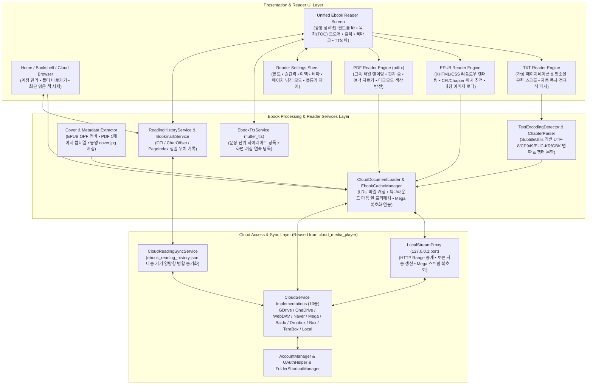
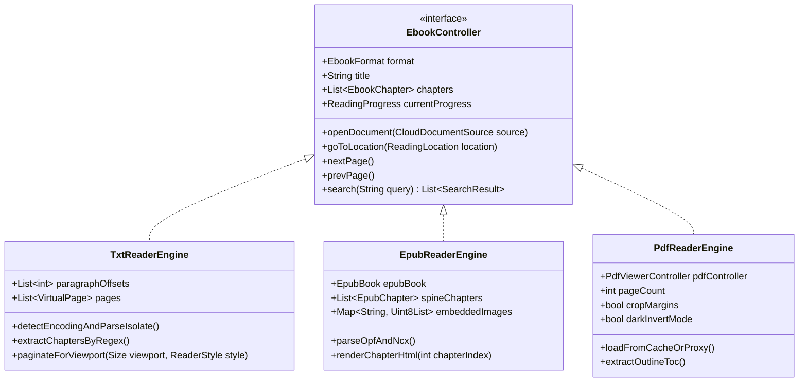
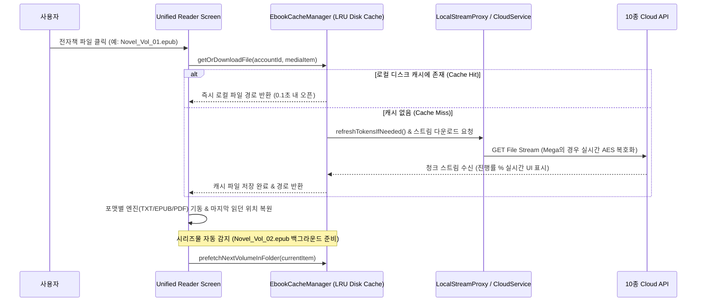

# Cloud Ebook Viewer 아키텍처 설계서 (Architecture & Design Specification)

> [!IMPORTANT]
> 본 문서는 기존 `cloud_media_player`의 10종 멀티 클라우드 스토리지 접근 계층, OAuth 인증/토큰 자동 갱신, 로컬 스트림 프록시(`LocalStreamProxy`), 인코딩 변환(`SubtitleUtils`), 다중 기기 동기화(`CloudPlaybackSyncService`) 인프라를 재활용하여 **`TXT / EPUB / PDF` 통합 클라우드 전자책 뷰어(`cloud_ebook_viewer`)**를 구축하기 위한 전체 시스템 아키텍처 설계서입니다.

---

## 1. 프로젝트 개요 및 핵심 설계 목표

### 1.1 프로젝트 경로 및 기반
- **신규 프로젝트 경로**: `D:\My Documents\AI\cloud_ebook_viewer`
- **베이스 코드베이스**:
  - `D:\My Documents\AI\cloud_media_player` (클라우드 10종 서비스, `LocalStreamProxy`, `SubtitleUtils` 인코딩 감지기, `CloudPlaybackSyncService`)
  - `D:\My Documents\AI\cloud_comic_viewer` (ZIP/압축 스트림 리더, 썸네일/캐시 매니저 참고)
- **타겟 플랫폼**: Android (스마트폰/태블릿/폴더블/E-Ink 리더기) 및 Windows 데스크톱

### 1.2 핵심 전환 포인트 (Media Player $\rightarrow$ Ebook Viewer)
1. **클라우드 레이어 100% 재사용**:
   - Google Drive, OneDrive, WebDAV, Box, Dropbox, TeraBox, Baidu, Naver MYBOX, Mega, Local Storage 등 10종 스토리지 인터페이스 및 `AccountManager`, `FolderShortcutManager`를 수정 없이 그대로 계승합니다.
2. **포맷별 최적화된 클라우드 로딩 파이프라인 (Streaming & Smart Caching)**:
   - **PDF**: 수십~수백 MB의 대용량 PDF를 전체 다운로드하지 않고도 즉시 열람할 수 있도록 `LocalStreamProxy`의 HTTP Range Request 또는 스마트 로컬 캐시(`EbookCacheManager`)와 네이티브 PDF 엔진(`pdfrx`)을 결합합니다.
   - **EPUB**: ZIP 기반 컨테이너 구조를 파싱(`epubx` / `archive`)하여 챕터(XHTML), 스타일시트(CSS), 내장 이미지, 목차(TOC, NCX/NAV)를 추출하고 리플로우(Reflowable) 페이지네이션/스크롤 뷰어로 렌더링합니다.
   - **TXT**: 기존 `SubtitleUtils.decodeSubtitleToUtf8String()`(UTF-8, CP949, EUC-KR, GBK 자동 감지 및 변환)을 그대로 재활용하여 구형 한글 텍스트 소설 파일 깨짐 문제를 원천 해결하고, 정규식(Regex) 기반 **자동 챕터/목차 추출** 및 **가상 페이지네이션(Virtual Pagination)**을 통해 10MB 이상의 장편 소설도 렉 없이 즉시 오픈합니다.
3. **전자책 전용 독서 경험(Reading UX) 및 클라우드 동기화**:
   - 글꼴(폰트 크기/줄간격/문단간격/여백), 배경 테마(주간/야간/세피아/눈보호 녹색/E-Ink 고대비), 넘김 방식(좌우 페이지 넘김, 상하 웹소설 스크롤, 볼륨키 넘김, 자동 넘김), 책갈피(Bookmark)/하이라이트/메모, TTS(음성 낭독) 기능을 통합 제공합니다.
   - 클라우드 루트의 `ebook_reading_history.json`을 통해 스마트폰(Android)과 PC(Windows) 간 **읽던 위치(진도율, 챕터, 문단/문자 오프셋, PDF 페이지) 및 북마크**를 양방향 자동 동기화합니다.

---

## 2. 전체 시스템 아키텍처



---

## 3. 기존 `cloud_media_player` 모듈 재사용 및 변경 명세

### 3.1 100% 그대로 재사용하는 모듈 (`lib/services/` & `lib/utils/`)
| 분류 | 대상 파일 | 역할 및 재사용 방식 |
| :--- | :--- | :--- |
| **클라우드 추상화 & 계정** | `cloud_service_interface.dart`, `cloud_account.dart`, `account_manager.dart`, `folder_shortcut.dart`, `folder_shortcut_manager.dart` | 10종 클라우드 계정 인증, 토큰 만료 갱신 콜백, 즐겨찾기 폴더 바로가기 100% 그대로 유지 |
| **10종 클라우드 구현체** | `google_drive_service.dart`, `onedrive_service.dart`, `webdav_service.dart`, `naver_box_service.dart`, `mega_service.dart`, `baidu_service.dart`, `terabox_service.dart`, `dropbox_service.dart`, `box_service.dart`, `local_disk_service.dart` | 폴더 탐색(`listItems`), 다운로드(`downloadBytes`), 스트림 URL(`getStreamUrl`), 파일 관리(이름변경/삭제/이동/복사) 수정 없이 재사용 |
| **인증 및 암호화 유틸** | `google_auth_manager.dart`, `oauth_helper.dart`, `mega_crypto_utils.dart`, `mega_api_client.dart`, `naver_box_api_client.dart` | OAuth 로그인, Mega AES-CTR 복호화 그대로 재사용 |
| **시스템 유틸리티** | `permission_utils.dart`, `platform_utils.dart`, `battery_utils.dart` | 저장소 권한, 플랫폼 분기, TTS 백그라운드 낭독 시 절전 예외 요청에 재사용 |

### 3.2 이북 뷰어용으로 확장/개조하는 모듈
1. **`models/media_item.dart`**:
   - **`EbookFormat` 열거형 및 `isEbook` 게터 추가**:
     - `EbookFormat { txt, epub, pdf, unknown }`
     - `isTxt`: `.txt`, `.md`, `.log` (`text/plain`)
     - `isEpub`: `.epub` (`application/epub+zip`)
     - `isPdf`: `.pdf` (`application/pdf`)
     - `isEbook`: `isTxt || isEpub || isPdf`
   - **`isCoverImage` 게터**: 같은 폴더 내 동명 이미지(`소설제목.jpg`) 또는 `cover.jpg` 매칭용.
2. **`utils/subtitle_utils.dart` $\rightarrow$ `utils/text_encoding_utils.dart`로 확장**:
   - 기존 `decodeSubtitleToUtf8String(List<int> rawBytes)`의 **BOM 감지 $\rightarrow$ Strict UTF-8 검증 $\rightarrow$ CP949 $\rightarrow$ EUC-KR $\rightarrow$ GBK $\rightarrow$ UTF-8 Fallback** 파이프라인을 100% 재활용합니다.
   - 추가 확장: 대용량 TXT 파일(예: 10~30MB)의 경우 앞부분 64KB 샘플만으로 인코딩을 1ms 내에 판별한 뒤 Isolate(백그라운드 스레드)에서 전체 디코딩을 수행하여 UI 버벅임을 방지합니다.
3. **`services/cloud_playback_sync_service.dart` $\rightarrow$ `services/cloud_reading_sync_service.dart`**:
   - 클라우드 루트 동기화 파일명을 `ebook_reading_history.json`으로 분리하여 기존 동영상 플레이어(`media_play_history.json`)와 충돌하지 않게 유지합니다.
   - 기존 Tombstone(삭제 기록) 병합 알고리즘과 Google Drive / OneDrive / WebDAV / Dropbox 업로드/다운로드 코드를 그대로 재사용합니다.

---

## 4. 포맷별 뷰어 엔진 상세 설계 (TXT / EPUB / PDF)

포맷마다 내부 구조가 전혀 다르므로, 공통 인터페이스인 `EbookController` 아래에 3개의 특화 엔진을 모듈식으로 배치합니다.



### 4.1 TXT 뷰어 엔진 (`TxtReaderEngine`)
클라우드에 저장된 텍스트 소설/문서 파일을 읽을 때 가장 중요한 요소는 **한글 인코딩 호환성**, **대용량 파일 로딩 속도**, **가독성 높은 조판**입니다.
- **인코딩 자동 감지 및 수동 전환**:
  - `TextEncodingUtils`가 UTF-8, UTF-16(LE/BE), CP949, EUC-KR, GBK, Shift-JIS를 자동 감지하며, 상단 메뉴에서 사용자가 인코딩을 수동으로 강제 변경할 수 있는 옵션도 제공합니다.
- **정규식 기반 스마트 목차(Auto-TOC) 생성**:
  - 별도 목차 데이터가 없는 `.txt` 파일에서 아래 패턴을 스캔하여 자동으로 챕터 목차를 생성합니다:
    - `^(제?\s*\d+\s*[장화편절부권회]|Chapter\s*\d+|Episode\s*\d+|\[\d+\]|\d+\.\s+.+)`
- **듀얼 렌더링 모드 (페이지 넘김 vs 웹소설 스크롤)**:
  1. **페이지 넘김 모드 (`PageView` + `TextPainter` 가상 페이지네이션)**:
     - 전체 텍스트를 한 번에 레이아웃하지 않고, 현재 문자 오프셋(`charOffset`) 주변 문단만 화면 크기(`Viewport Size`)와 폰트/줄간격 설정에 맞춰 `TextPainter`로 정밀 분할합니다.
     - 폰트 크기를 바꿔도 `charOffset`(전체 글자 중 몇 번째 글자인지)을 기준으로 정확한 위치를 유지합니다.
  2. **웹소설 스크롤 모드 (`ScrollablePositionedList` 문단 리스트)**:
     - 줄바꿈 단위로 문단을 나누어 `ListView.builder` 형태로 렌더링하여, 20MB 이상의 텍스트도 메모리 과부하 없이 부드럽게 스크롤합니다.
- **텍스트 정리 옵션 (Text Reflow & Cleanup)**:
  - 불필요한 강제 개행(줄바꿈) 합치기, 문단 첫 줄 들여쓰기(1칸/2칸) 자동 적용, 문단 간 여백 조절.

### 4.2 EPUB 뷰어 엔진 (`EpubReaderEngine`)
EPUB은 내부적으로 ZIP 압축된 XHTML + CSS + 이미지 + OPF/NCX 메타데이터 구조입니다.
- **파싱 및 리소스 관리**:
  - `epubx` 및 `archive` 패키지를 활용하여 메모리 또는 로컬 캐시 파일에서 즉시 컨테이너를 언팩합니다.
  - 책 표지(`Cover Image`), 저자(`Author`), 출판사, 공식 목차(`TOC` - NCX 및 EPUB3 NAV)를 추출합니다.
  - EPUB 내부의 삽화/이미지(``)는 메모리에 바이트 맵 또는 임시 캐시 디렉터리에 풀어서 오프라인/온라인 관계없이 즉시 렌더링하며, 삽화 탭 시 핀치 줌(확대 보기)을 지원합니다.
- **리플로우(Reflowable) 렌더링 아키텍처**:
  - 사용자의 커스텀 스타일(폰트 패밀리, 글자 크기, 줄간격, 좌우 여백, 배경색/글자색 테마)을 오버라이드하여 렌더링합니다.
  - 챕터 간 끊김 없는 이동: 마지막 페이지에서 다음으로 넘기면 자동으로 다음 챕터 첫 페이지로 이어지며, 위치 저장은 **`chapterIndex + chapterCharOffset (또는 CFI)`** 조합을 사용하여 기기 화면 크기가 달라도(예: PC 모니터 $\leftrightarrow$ 스마트폰) 정확히 읽던 문장으로 복원합니다.

### 4.3 PDF 뷰어 엔진 (`PdfReaderEngine`)
PDF는 고정 레이아웃(Fixed Layout) 문서 및 스캔본 도서가 많으므로 고성능 네이티브 렌더링이 필수입니다.
- **엔진 선정 (`pdfrx` - PDFium 기반 고성능 Flutter 엔진)**:
  - Android와 Windows 모두에서 60~120fps 타일 렌더링, 텍스트 선택/복사, 문서 내 텍스트 검색(하이라이트), 내장 목차(Outline) 추출, 링크 점프를 완벽히 지원합니다.
- **클라우드 대용량 PDF 처리 전략**:
  - `EbookCacheManager`를 통해 다운로드 진행률 바를 표시하며 로컬 캐시 디렉터리에 스트리밍 저장합니다. (재열람 시 네트워크 소모 0, 즉시 오픈)
  - `pdfrx`의 `PdfDocument.openUri` / `openFile`을 활용하여 `LocalStreamProxy` 연동 및 로컬 캐시 읽기를 모두 지원합니다.
- **PDF 특화 편의 기능**:
  - **다크 모드(색상 반전 / 세피아 필터)**: 밤에 눈이 부신 흰색 배경 PDF를 `ColorFilter.matrix`로 자연스럽게 다크 모드나 세피아 톤으로 변환(이미지 반전 제외 옵션 포함).
  - **여백 자동/수동 자르기 (Margin Crop & Zoom Lock)**: 모바일 작은 화면에서 PDF 바깥쪽 흰 여백을 숨기고 본문 영역만 꽉 차게 확대 고정하는 기능.
  - **양면 보기 (Two-Page Spread)**: 태블릿 가로 모드 및 Windows 데스크톱에서 실제 책처럼 2페이지 나란히 보기 지원(표지 단독 표시 옵션 포함).

---

## 5. 클라우드 파일 로딩, 캐싱 및 다음 권 프리페치 전략

동영상 스트리밍과 달리 전자책은 파일 크기가 상대적으로 작고(TXT: 0.5~15MB, EPUB: 2~30MB, PDF: 10~200MB), 한 번 연 책을 수일~수주 동안 반복해서 열람하는 특성이 있습니다.



1. **스마트 디스크 캐시 (`EbookCacheManager`)**:
   - `path_provider`의 `ApplicationSupportDirectory` 하위에 `ebook_cache/` 폴더를 두고 최대 용량(예: 기본 1GB, 설정에서 500MB~5GB 조절 가능) 내에서 **LRU(Least Recently Used)** 방식으로 자동 관리합니다.
   - Mega(`MegaService`)처럼 암호화된 클라우드 파일도 `LocalStreamProxy` 또는 `MegaService`의 복호화 스트림을 거쳐 복호화된 캐시 파일로 저장되므로 두 번째 열람부터는 지연 시간이 전혀 없습니다.
2. **시리즈물 이전 권 / 다음 권 자동 탐색**:
   - 같은 클라우드 폴더 내의 파일들을 자연 정렬(`Natural Sort`: 1권, 2권, ..., 10권)하여, 뷰어 하단 바 또는 마지막 페이지 도달 시 **`[다음 권 바로 읽기]`** 버튼을 표시합니다.
3. **표지(Cover) 및 썸네일 캐싱 (`CoverExtractorService`)**:
   - 서재(Home) 및 브라우저에서 책을 시각적으로 보여주기 위해, 최초 열람 시 추출한 EPUB 표지 이미지 또는 PDF 1페이지 렌더링 스냅샷을 로컬 썸네일 캐시에 저장합니다.

---

## 6. 전자책 전용 공통 기능 및 UI/UX 설계

### 6.1 뷰어 공통 설정 (`ReaderSettings`)
existing `SubtitleSettingsService`와 유사한 구조로 `ReaderSettingsService`를 구축하여 실시간 반영 및 영구 저장합니다.
- **타이포그래피 (TXT / EPUB 공통)**:
  - 글꼴 선택: 시스템 기본, 본고딕(Noto Sans KR), 본명조(Noto Serif KR), 나눔고딕/명조, 리디바탕/마루부리 등 사용자 커스텀 `.ttf/.otf` 폰트 파일(클라우드에서 직접 불러오기 지원!)
  - 글자 크기 (`12pt ~ 36pt`), 줄간격 (`1.2 ~ 2.5`), 문단 간격, 자간, 좌우/상하 여백, 양쪽 정렬(Justify) 여부
- **컬러 테마 프리셋**:
  - ☀️ **주간 화이트** (`#FFFFFF` 배경 / `#1A1A1A` 텍스트)
  - 📜 **세피아 (종이책)** (`#F4ECD8` 배경 / `#3B2F2F` 텍스트)
  - 🌿 **눈보호 그린** (`#C7EDCC` 배경 / `#1E2E22` 텍스트)
  - 🌙 **야간 다크** (`#1E1E1E` 배경 / `#CCCCCC` 텍스트)
  - 🖤 **AMOLED 리얼 블랙** (`#000000` 배경 / `#999999` 텍스트)
- **조작 및 하드웨어 연동**:
  - **화면 터치 영역 9분할(3x3 Grid) 액션 매핑**: 좌측 터치(이전 페이지/다음 페이지 선택 가능 - 한 손 조작 배려), 우측 터치(다음 페이지), 중앙 터치(메뉴 토글).
  - **볼륨 버튼 페이지 넘김**: 스마트폰 물리 볼륨 상/하 버튼으로 페이지 넘김 지원 (E-Ink 리더기 및 한 손 독서 필수 기능).
  - **좌측 가장자리 상하 드래그**: 기존 `cloud_media_player`의 `screen_brightness` 코드를 재활용하여 뷰어 내 화면 밝기 즉시 조절 + 야간 청색광 필터(Warmth 오버레이).
  - **자동 넘김 (Auto Page Turn / Auto Scroll)**: 지정한 초(예: 10~60초)마다 페이지 자동 넘김 또는 일정 속도로 텍스트 자동 스크롤.

### 6.2 독서 위치(진도) 기록 및 다중 기기 클라우드 동기화 (`ReadingRecord`)
기존 `PlaybackRecord`(`positionMs / durationMs`)를 전자책에 맞게 확장한 `ReadingRecord` 모델을 정의합니다.
```json
{
  "bookKey": "gdrive_account1::fileId_12345",
  "title": "나 혼자만 레벨업 1권.epub",
  "format": "epub",
  "accountId": "gdrive_account1",
  "fileId": "fileId_12345",
  "parentId": "folderId_999",
  "progressRatio": 0.425,
  "chapterIndex": 12,
  "chapterTitle": "제12장 이중 던전",
  "charOffset": 4520,
  "pdfPage": 1,
  "totalPages": 320,
  "updatedAt": 1762224000000,
  "bookmarks": [
    {
      "id": "bm_01",
      "chapterIndex": 12,
      "charOffset": 4520,
      "snippet": "성진우는 숨을 죽이고 제단 앞의 석상을 바라보았다...",
      "note": "명장면 시작",
      "color": "#FFD54F",
      "createdAt": 1762223900000
    }
  ]
}
```
- **정밀 복원**:
  - **TXT**: `charOffset` (전체 텍스트 내 문자 인덱스) 기준으로 복원하므로 폰트 크기나 창 크기가 달라도 정확히 읽던 문장부터 시작합니다.
  - **EPUB**: `chapterIndex` + `charOffset` 기준으로 복원합니다.
  - **PDF**: `pdfPage` + `zoomScale/scrollOffset` 기준으로 복원합니다.
- **클라우드 자동 동기화**:
  - 페이지를 넘기거나 뷰어를 닫을 때 3초 디바운스(Debounce)로 클라우드 루트의 `ebook_reading_history.json`에 자동 백업 및 병합(`Pull & Merge -> Push`)합니다.

### 6.3 부가 기능: 본문 검색 & TTS (음성 낭독)
1. **본문 내 전체 검색 (`In-Book Search`)**:
   - TXT 전체 본문, EPUB 전 챕터, PDF 전체 페이지에서 키워드를 검색하여 앞뒤 문맥 미리보기 리스트를 보여주고, 탭하면 즉시 해당 위치로 이동합니다.
2. **TTS 오디오북 모드 (`EbookTtsService`)**:
   - `flutter_tts`를 연동하여 TXT 및 EPUB 본문을 문장 단위로 끊어서 읽어주며, 현재 읽고 있는 문장을 화면에 실시간 하이라이트하고 페이지를 자동으로 넘겨줍니다.

---

## 7. 디렉터리 구조 설계 (`cloud_ebook_viewer`)

```text
D:\My Documents\AI\cloud_ebook_viewer\
├── android/                                     # 권한, 볼륨키 인터셉트 채널(MainActivity.kt), 화면 켜짐 유지
├── windows/                                     # window_manager 데스크톱 단축키(방향키/Space/PageUp/Down/F11)
├── lib/
│   ├── main.dart                                # LocalStreamProxy 기동, MultiProvider, 테마 초기화
│   ├── models/
│   │   ├── cloud_account.dart                   # [재사용] 10종 클라우드 계정 모델
│   │   ├── folder_shortcut.dart                 # [재사용] 폴더 바로가기 모델
│   │   ├── media_item.dart                      # [확장] isEbook, isTxt, isEpub, isPdf, EbookFormat 추가
│   │   ├── ebook_document.dart                  # [신규] 통합 전자책 문서 메타데이터 및 챕터(TOC) 모델
│   │   ├── reading_record.dart                  # [신규] 독서 진도(charOffset/chapter/page) 및 북마크/메모 모델
│   │   └── reader_settings.dart                 # [신규] 폰트, 줄간격, 여백, 컬러 테마, 터치존, 넘김 방식 모델
│   ├── services/
│   │   ├── cloud_service_interface.dart         # [재사용] 클라우드 공통 추상 인터페이스
│   │   ├── account_manager.dart                 # [재사용] 클라우드 계정 매니저
│   │   ├── folder_shortcut_manager.dart         # [재사용] 폴더 바로가기 매니저
│   │   ├── (10종 클라우드 서비스 파일들)         # [재사용] GDrive, OneDrive, WebDAV, Naver, Mega, Baidu 등
│   │   ├── local_stream_proxy.dart              # [재사용] 로컬 HTTP 프록시 & Mega 실시간 복호화
│   │   ├── ebook_cache_manager.dart             # [신규] 클라우드 전자책 로컬 디스크 LRU 캐시 & 다음 권 프리페치
│   │   ├── cover_extractor_service.dart         # [신규] EPUB/PDF 표지 추출 및 로컬 썸네일 캐시 서비스
│   │   ├── reading_history_service.dart         # [신규] 로컬 독서 기록 및 북마크/하이라이트 저장소
│   │   ├── cloud_reading_sync_service.dart      # [개조] ebook_reading_history.json 클라우드 양방향 동기화
│   │   ├── reader_settings_service.dart         # [신규] 뷰어 조판/테마/조작 설정 영구 저장 및 알림
│   │   └── ebook_tts_service.dart               # [신규] 문장 단위 TTS 낭독 및 자동 페이지 넘김 서비스
│   ├── engines/
│   │   ├── ebook_controller.dart                # [신규] 포맷 무관 뷰어 공통 제어 인터페이스
│   │   ├── txt/
│   │   │   ├── txt_reader_engine.dart           # [신규] 대용량 TXT 파서, 정규식 챕터 추출, 가상 페이지네이터
│   │   │   └── txt_reader_view.dart             # [신규] TXT 페이지 넘김 뷰 & 웹소설 스크롤 뷰 위젯
│   │   ├── epub/
│   │   │   ├── epub_reader_engine.dart          # [신규] EPUB 언팩, OPF/NCX 목차 파싱, 챕터 HTML/CSS 정제
│   │   │   └── epub_reader_view.dart            # [신규] EPUB 리플로우 뷰어 & 내장 삽화 뷰어 위젯
│   │   └── pdf/
│   │       ├── pdf_reader_engine.dart           # [신규] pdfrx 컨트롤러 래퍼, Outline 목차 추출, 여백 크롭 계산
│   │       └── pdf_reader_view.dart             # [신규] PDF 고성능 뷰어 (다크모드 필터, 양면보기, 줌 고정)
│   ├── ui/
│   │   ├── screens/
│   │   │   ├── home_screen.dart                 # [개조] 내 서재(최근 읽은 책 그리드/리스트) + 클라우드 계정 & 폴더
│   │   │   ├── browser_screen.dart              # [개조] 전자책 필터링 브라우저 (진도율 배지, 표지 썸네일 표시)
│   │   │   └── ebook_reader_screen.dart         # [신규] 통합 리더 호스트 화면 (상하단 HUD, 볼륨키/단축키 리스너)
│   │   └── widgets/
│   │       ├── reader_top_bar.dart              # [신규] 제목, 북마크 추가, 본문 검색, 인코딩 변경, TTS 버튼
│   │       ├── reader_bottom_bar.dart           # [신규] 페이지/진도 슬라이더, 이전/다음 챕터, 목차, 설정 시트 버튼
│   │       ├── toc_bookmark_drawer.dart         # [신규] 목차(TOC) 탭 + 북마크/메모 목록 사이드 드로어
│   │       ├── reader_settings_sheet.dart       # [신규] 테마/폰트/줄간격/여백/넘김모드 실시간 조절 바텀 시트
│   │       └── in_book_search_sheet.dart        # [신규] 본문 키워드 검색 및 결과 점프 시트
│   └── utils/
│       ├── text_encoding_utils.dart             # [확장] SubtitleUtils 기반 한글/다국어 인코딩 고속 감지 및 변환
│       ├── natural_sort_utils.dart              # [재사용] 권수(1권, 2권, 10권) 자연 정렬 유틸리티
│       ├── mega_crypto_utils.dart               # [재사용] Mega 복호화 유틸리티
│       └── permission_utils.dart                # [재사용] 권한 유틸리티
└── pubspec.yaml
```

---

## 8. 추가 및 변경될 주요 패키지 (`pubspec.yaml`)

기존 `cloud_media_player`에서 비디오 전용 패키지(`media_kit`, `media_kit_video` 등 무거운 동영상 코덱 라이브러리)를 제거하여 앱 용량을 대폭 줄이고, 전자책 전용 경량/고성능 패키지로 교체합니다.

| 구분 | 패키지명 | 용도 |
| :--- | :--- | :--- |
| **유지 (클라우드/인코딩/시스템)** | `http`, `dio`, `provider`, `shared_preferences`, `flutter_secure_storage`, `google_sign_in`, `url_launcher`, `crypto`, `pointycastle`, `xml`, `charset_converter`, `fast_gbk`, `path_provider`, `file_picker`, `window_manager`, `screen_brightness`, `wakelock_plus` | 10종 클라우드 통신, Mega 암호화, 한글 CP949/EUC-KR 인코딩 변환, 화면 밝기 및 켜짐 유지 |
| **제거 (비디오 전용)** | `media_kit`, `media_kit_video`, `media_kit_libs_*` | 동영상 재생 엔진 제거 (APK/EXE 빌드 크기 약 40~60MB 절감) |
| **신규 추가 (PDF 엔진)** | `pdfrx` | PDFium 기반 초고속 크로스플랫폼(Android/Windows) PDF 렌더링, 텍스트 검색, Outline 추출 |
| **신규 추가 (EPUB/압축)** | `epubx` (또는 커스텀 OPF 파서), `archive`, `html` | EPUB 컨테이너 언팩, 메타데이터/목차/XHTML 본문 파싱 |
| **신규 추가 (뷰어 UI/TTS)** | `scrollable_positioned_list`, `flutter_widget_from_html_core`, `flutter_tts`, `photo_view` | 대용량 문단 인덱스 점프 스크롤, EPUB XHTML/CSS 리플로우 렌더링, 음성 낭독(TTS), 삽화 확대 |

---

## 9. 단계별 구현 로드맵 (Implementation Roadmap)

향후 코딩 작업 착수 시 아래 5단계 순서로 진행합니다.

- **Phase 1: 프로젝트 생성 및 클라우드 코어 이식**
  - `D:\My Documents\AI\cloud_ebook_viewer` 프로젝트 생성 후 10종 클라우드 서비스, `AccountManager`, `FolderShortcutManager`, `LocalStreamProxy` 이식.
  - `MediaItem`에 전자책 포맷(`TXT`, `EPUB`, `PDF`) 판별 로직 추가 및 `EbookCacheManager`(로컬 캐싱 + 다운로드 진행률) 구현.
- **Phase 2: TXT 뷰어 엔진 및 한글 인코딩/자동 목차 구현**
  - `TextEncodingUtils`(UTF-8/CP949/EUC-KR/GBK 자동 변환) 및 정규식 기반 챕터 목차 자동 추출기 구현.
  - 가상 페이지네이션(좌우 페이지 넘김) 및 웹소설 무한 스크롤 모드, 타이포그래피/테마 설정 시트 구현.
- **Phase 3: EPUB 뷰어 엔진 구현**
  - EPUB 파싱(표지, 메타데이터, NCX/NAV 목차, 챕터 XHTML, 내장 이미지) 및 리플로우 뷰어 연동.
  - 챕터 간 연속 페이지 넘김 및 `chapterIndex + charOffset` 정밀 위치 추적 구현.
- **Phase 4: PDF 뷰어 엔진 구현**
  - `pdfrx` 연동, 내장 목차(Outline) 드로어, 다크 모드 색상 반전 필터, 모바일 여백 자르기(Margin Crop), 태블릿/PC 양면 보기 구현.
- **Phase 5: 서재 UI, 북마크/검색/TTS, 클라우드 다중 기기 동기화**
  - `ReadingHistoryService` 및 `CloudReadingSyncService`(`ebook_reading_history.json`) 양방향 동기화 완성.
  - 본문 검색, 북마크/메모 관리, TTS 음성 낭독, 볼륨키 페이지 넘김 및 다음 권 자동 이어읽기 마무리.
