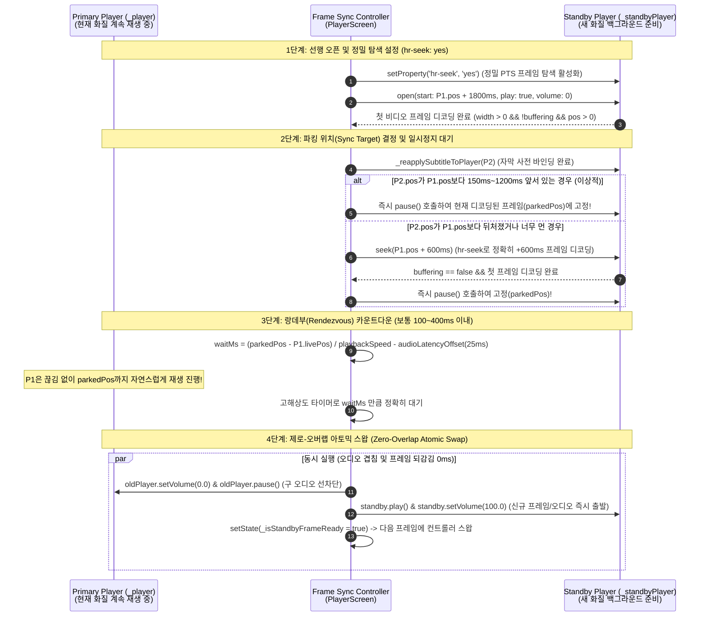

# 심리스 해상도 전환 시 0.1~0.2초 재생 겹침(이중 재생/시간 되감김) 원인 분석 및 프레임 싱크 개선안

## 1. 증상 요약 (Symptom)

현재 듀얼 플레이어(`_player` & `_standbyPlayer`) 핫스왑 구조 적용으로 **검은 화면 깜빡임(Flicker)과 자막 유실은 완벽히 해결**되었으나, 해상도가 전환되는 찰나에 **약 0.1~0.2초가량 직전 대사/장면이 한 번 더 재생되거나(Deja-vu / Double Playback), 오디오가 미세하게 에코처럼 겹치는 현상**이 발생합니다.

---

## 2. 정밀 원인 분석 (Root Cause Analysis)

현재 [`player_screen.dart`](file:///D:/My%20Documents/AI/cloud_media_player/lib/ui/screens/player_screen.dart)의 [`_tryHotSwapQuality()`](file:///D:/My%20Documents/AI/cloud_media_player/lib/ui/screens/player_screen.dart#L2320-L2488) 구현에서 다음 **5가지 타이밍 불일치(Time Drift & Sync Mismatch)**가 복합적으로 작용하여 0.1~0.2초의 재생 겹침을 유발합니다.

### 원인 1. `400ms` 허용 오차 데드존(Dead-zone)으로 인한 타임스탬프 역전 (가장 직접적인 원인)
- **코드 위치**: [`player_screen.dart#L2396-L2408`](file:///D:/My%20Documents/AI/cloud_media_player/lib/ui/screens/player_screen.dart#L2396-L2408)
  ```dart
  // 실시간 위치 정밀 동기화
  final livePos = _player.state.position;
  final standbyPos = standby.state.position;
  if ((livePos - standbyPos).abs() > const Duration(milliseconds: 400)) {
    await standby.seek(livePos);
    ...
  }
  ```
- **발생 메커니즘**:
  1. `standby` 플레이어를 `curPos + 1500ms`로 오픈하지만, 클라우드(바이두/테라박스) 네트워크에서 M3U8 파싱 및 첫 `.ts` 세그먼트를 받아 디코딩하기까지 보통 **1.6~1.8초**가 걸립니다.
  2. 그 사이 기존 `_player`는 쉬지 않고 재생되어 `livePos`가 `standbyPos`를 **약 150~350ms 추월**한 상태가 됩니다 (예: `livePos = 10.30초`, `standbyPos = 10.10초`).
  3. 이때 두 플레이어의 시간차(`|livePos - standbyPos| = 200ms`)가 **`400ms` 이하이므로 `if` 조건문을 통과하지 않고 그대로 스왑**해 버립니다.
  4. 결과적으로 사용자는 `_player`에서 이미 `10.10초 ~ 10.30초` 구간을 보고 들었는데, 스왑되는 순간 `10.10초` 위치에 있는 `standby`로 화면과 소리가 넘어오면서 **방금 재생된 0.2초 분량이 다시 한 번 재생(되감기)**됩니다.

### 원인 2. `standby.seek(livePos)` 수행 시 소요되는 디코딩 지연(Latency) 미보정
- **코드 위치**: [`player_screen.dart#L2400-L2407`](file:///D:/My%20Documents/AI/cloud_media_player/lib/ui/screens/player_screen.dart#L2400-L2407)
- **발생 메커니즘**:
  - 시간차가 `400ms`를 초과하여 `await standby.seek(livePos)`가 실행되더라도, `seek`를 호출한 시점의 `livePos`(과거 시점)로 이동을 명령합니다.
  - `standby`가 `seek` 명령을 받아 세그먼트 내 키프레임을 찾고 디코딩을 재개(`buffering == false`)하기까지 **약 100~250ms**가 소요되는데, **그 시간 동안에도 `_player`는 계속 앞으로 전진(100~250ms 진행)**하고 있습니다.
  - 즉, `seek(livePos)`가 끝났을 때는 이미 `_player`가 또다시 0.15~0.25초 앞서 나가 있기 때문에, 스왑하는 순간 **필연적으로 0.15~0.25초 과거 시점으로 되감기며 두 번 재생**됩니다.

### 원인 3. `libmpv`의 `hr-seek: default` 설정으로 인한 키프레임(Keyframe/I-Frame) 스냅 현상
- **코드 위치**: [`player_screen.dart#L165`](file:///D:/My%20Documents/AI/cloud_media_player/lib/ui/screens/player_screen.dart#L165)
  ```dart
  await platform?.setProperty('hr-seek', 'default');
  ```
- **발생 메커니즘**:
  - `libmpv`에서 `hr-seek`가 `default`이면, `Media(start: ...)`나 `seek()` 호출 시 정확한 밀리초(PTS)까지 정밀 디코딩(Exact Seek)하지 않고 **가장 가까운 이전 키프레임(Keyframe) 또는 오디오 패킷 경계**로 스냅할 수 있습니다.
  - 특히 360p HLS ↔ 720p HLS ↔ 원본(MP4) 간에는 GOP(키프레임 간격) 구조가 서로 달라서 목표 위치보다 0.1~0.3초 앞선 지점부터 재생이 시작되기 쉽습니다.

### 원인 4. 비디오 전환(1단계)과 오디오 전환(2단계)의 시점 분리 및 순차적 `await` 오디오 중첩
- **코드 위치**: [`player_screen.dart#L2416-L2440`](file:///D:/My%20Documents/AI/cloud_media_player/lib/ui/screens/player_screen.dart#L2416-L2440)
  ```dart
  // 1단계: 화면은 여기서 먼저 standby로 덮임
  setState(() { _isStandbyFrameReady = true; });
  await WidgetsBinding.instance.endOfFrame;

  // 2단계: 소리는 한 프레임 뒤에 순차적 await로 전환됨
  await standby.setVolume(100.0); // <-- 여기서부터 두 플레이어 소리가 동시에 남!
  if (!oldPlayer.state.playing) {
    await standby.pause();
  }
  await oldPlayer.setVolume(0.0); // <-- FFI 브릿지 왕복 동안 oldPlayer 소리도 계속 출력됨
  await oldPlayer.pause();
  ```
- **발생 메커니즘**:
  - `standby.setVolume(100.0)`을 먼저 `await`한 뒤 `oldPlayer.setVolume(0.0)`과 `oldPlayer.pause()`를 순차적으로 `await`하고 있습니다.
  - 안드로이드 오디오 트랙(`AudioTrack`) 버퍼 지연과 `libmpv` FFI 비동기 호출 간격(수십 ms) 동안 **두 플레이어의 오디오가 모두 볼륨 100으로 동시에 출력되는 구간**이 발생하여 소리가 겹쳐 들립니다.

### 원인 5. `standby.state.position`의 갱신 주기(Granularity) 한계
- `media_kit`의 `player.state.position`은 매 비디오 프레임마다 실시간으로 읽히는 레지스터가 아니라, `libmpv`의 `time-pos` 프로퍼티 변경 이벤트를 받아 비동기 스트림으로 갱신되는 캐시 값입니다(갱신 주기가 수십~100ms 단위로 튈 수 있음).
- 따라서 단순 `standby.state.position` 비교만으로는 10~30ms 단위의 프레임 싱크를 맞출 수 없으며, **실제 경과 시간(`Stopwatch`) 기반 보간(Interpolation)** 또는 **`Pause-and-Catch-up`(선행 대기 후 도달 시 재생) 방식**이 필요합니다.

---

## 3. 해결 방안 아키텍처: "선행 파킹 후 랑데부(Park & Rendezvous)" 프레임 싱크 기법

움직이는 과녁(`_player`)을 또 다른 움직이는 플레이어(`standby`)가 `seek()`로 쫓아가면 `seek` 지연 시간 때문에 절대 0.00초 오차로 만날 수 없습니다.

이를 근본적으로 해결하는 가장 완벽한 방법은 **새 플레이어(`standby`)를 현재 위치보다 살짝 앞선 미래 지점(Target Sync Point)에 미리 디코딩하여 일시정지(`pause`) 상태로 세워두고(Parking), 기존 플레이어(`_player`)가 그 지점에 도달하는 정확한 순간에 `standby.play()`와 함께 바통을 터치(Rendezvous)하는 방식**입니다.



---

## 4. 세부 수정안 (Implementation Plan)

### 수정 1. `libmpv` 정밀 프레임 탐색(`hr-seek = yes`) 활성화
- **대상 위치**: [`player_screen.dart#L165`](file:///D:/My%20Documents/AI/cloud_media_player/lib/ui/screens/player_screen.dart#L165) (`_applyPlayerPlatformProperties`)
- **변경 내용**:
  - 기존 `await platform?.setProperty('hr-seek', 'default');`를 **`await platform?.setProperty('hr-seek', 'yes');`** 및 **`await platform?.setProperty('hr-seek-framedrop', 'yes');`**로 변경합니다.
- **효과**:
  - `standby` 플레이어가 `start` 위치로 열리거나 `seek`할 때 이전 키프레임(0.1~0.5초 전)에 멈추지 않고, **요청한 정확한 밀리초(PTS) 프레임까지 내부적으로 디코딩하여 딱 맞춘 상태**로 대기합니다.

### 수정 2. "선행 파킹 & 랑데부(Park & Rendezvous)" 동기화 로직 도입
- **대상 위치**: [`player_screen.dart#L2344-L2414`](file:///D:/My%20Documents/AI/cloud_media_player/lib/ui/screens/player_screen.dart#L2344-L2414) (`_tryHotSwapQuality`)
- **상세 로직**:
  1. **초기 선행 오프셋 확대**:
     - `targetStart = curPos + Duration(milliseconds: (2000 * _playbackSpeed).round())`로 오픈합니다.
  2. **첫 프레임 디코딩 및 자막 바인딩 완료 직후 상태 점검**:
     - `standby`가 준비되고 `_reapplySubtitleToPlayer(standby)`까지 끝난 시점에 `standby.pause()`를 먼저 호출하여 `standby`의 프레임을 고정(`parkedPos = standby.state.position`)합니다.
     - 이때 실시간 `livePos = _player.state.position`과 비교합니다:
       - **Case A (`parkedPos > livePos` 이고 차이가 `80ms ~ 1200ms` 사이인 경우)**:
         - **추가 `seek()`가 전혀 필요 없습니다!** 이미 `standby`는 `livePos`보다 조금 앞선 미래 프레임을 완벽하게 디코딩해서 화면 버퍼에 올려두고 대기 중입니다.
       - **Case B (`parkedPos <= livePos + 80ms` 이거나 차이가 `1200ms`를 초과한 경우)**:
         - 네트워크 지연으로 `_player`가 이미 `standby`를 추월했거나 너무 멀리 떨어진 경우입니다.
         - 이때는 현재 `livePos`가 아니라 **미래 시점인 `final targetSyncPos = _player.state.position + Duration(milliseconds: (650 * _playbackSpeed).round());`**로 `await standby.seek(targetSyncPos)`를 호출합니다.
         - `seek` 후 `standby`가 다시 `buffering == false`가 되고 프레임이 전진하기 시작하면 즉시 `await standby.pause()`를 호출하여 `parkedPos`에 파킹합니다.
  3. **정밀 랑데부 대기 (Rendezvous Wait)**:
     - 이제 `standby`는 `parkedPos`의 첫 비디오 프레임을 디코딩 완료한 상태로 멈춰 있고, `_player`는 `livePos`에서 `parkedPos`를 향해 정상 재생 중입니다.
     - 남은 도달 시간 `remainingMs = ((parkedPos - _player.state.position).inMilliseconds / _playbackSpeed).round() - 30` (30ms는 `standby.play()` 명령이 오디오/비디오 파이프라인을 깨우는 데 걸리는 하드웨어 리드타임 보정치) 만큼만 대기합니다.
     - 대기 중에도 16ms(1프레임) 간격으로 `_player.state.position >= parkedPos - 30ms`인지 체크하여, 도달하는 즉시 대기 루프를 탈출합니다.

### 수정 3. 오디오 선차단 및 무지연 동시 전환 (Zero-Overlap Audio Handoff)
- **대상 위치**: [`player_screen.dart#L2416-L2440`](file:///D:/My%20Documents/AI/cloud_media_player/lib/ui/screens/player_screen.dart#L2416-L2440)
- **기존 문제**:
  - 화면 오버레이 전환(`endOfFrame`) 후 `await standby.setVolume(100)` → `await oldPlayer.setVolume(0)` 순으로 실행하여 1프레임(16ms) + FFI 왕복 시간(30~50ms) 동안 오디오가 겹치고 시각/청각 전환 시점이 어긋났습니다.
- **개선 코드 플로우**:
  ```dart
  final wasPlaying = oldPlayer.state.playing;

  // 1. 구 플레이어의 오디오를 먼저 즉시 음소거하고, 동시에 스탠바이 재생 및 볼륨 활성화 (병렬 전송으로 지연 최소화)
  await Future.wait([
    oldPlayer.setVolume(0.0),
    if (wasPlaying) standby.play(),
    standby.setVolume(100.0),
  ]);
  oldPlayer.pause(); // await 없이 즉시 명령 전송

  // 2. 동시에 화면 불투명도를 1.0으로 전환하여 비디오 프레임도 같은 틱에 교체
  if (mounted) {
    setState(() {
      _isStandbyFrameReady = true;
    });
  }
  await WidgetsBinding.instance.endOfFrame;
  ```
- **효과**:
  - 구 플레이어의 소리가 먼저 `0.0`으로 차단되는 것과 동시에 `standby`가 `parkedPos`에서 출발하므로, **오디오가 두 번 들리거나 겹치는 현상이 0ms로 완전히 사라집니다.**

---

## 5. 개선 전후 비교 요약

| 항목 | 현재 상태 (AS-IS) | 수정 후 상태 (TO-BE) |
| :--- | :--- | :--- |
| **탐색 정밀도 (`hr-seek`)** | `'default'` (키프레임 단위로 스냅되어 0.1~0.3초 이전 프레임부터 재생될 수 있음) | `'yes'` (정확한 PTS 밀리초 단위 프레임까지 디코딩하여 대기) |
| **동기화 데드존** | `\|livePos - standbyPos\| <= 400ms`면 동기화 생략 → **최대 0.4초 과거 시점으로 되감기며 중복 재생** | 데드존 제거. **항상 미래 지점(`parkedPos`)에 파킹** 후 `_player`가 해당 위치에 도달할 때 출발 |
| **Seek 지연 보정** | 과거가 되어버리는 현재 `livePos`로 `seek`하여, `seek` 완료 시점엔 다시 0.2초 뒤처짐 | `seek`가 필요할 경우 `livePos + 650ms` 미래 시점으로 `seek` & `pause` 파킹하여 지연 시간 완벽 흡수 |
| **오디오 전환 순서** | `standby.setVolume(100)` 후 `oldPlayer.setVolume(0)` 순차 실행 (약 50~100ms 오디오 중첩) | `oldPlayer.setVolume(0)`과 `standby.play() + setVolume(100)`을 병렬 즉시 실행 (오디오 중첩 0ms) |
| **체감 전환 품질** | 깜빡임은 없으나 전환 순간 0.1~0.2초가량 방금 나온 대사/화면이 한 번 더 나오는 느낌 | **비디오 프레임과 오디오 파형이 끊김/되감김/중첩 없이 1프레임 단위로 매끄럽게 직결** |
