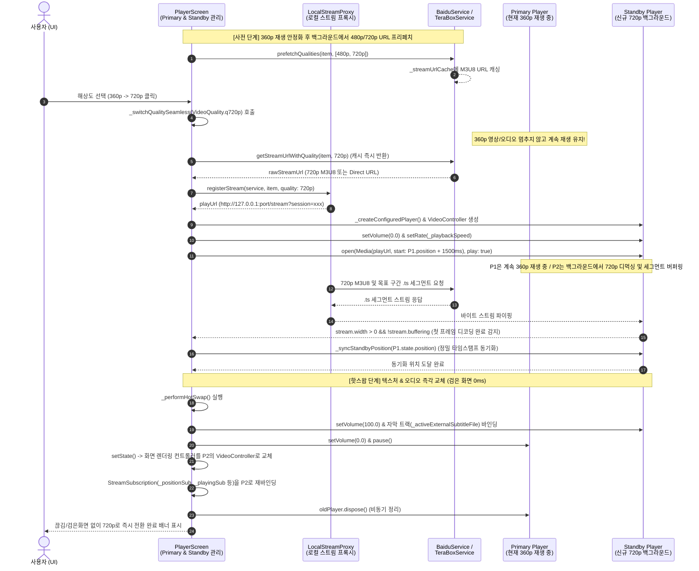

# Seamless Resolution Switching (심리즈 해상도 전환) 설계 및 코드 플로우 문서

## 1. 문제 원인 진단 (Root Cause Analysis)

현재 [`player_screen.dart`](file:///D:/My%20Documents/AI/cloud_media_player/lib/ui/screens/player_screen.dart)의 [`_switchQuality()`](file:///D:/My%20Documents/AI/cloud_media_player/lib/ui/screens/player_screen.dart#L2086-L2226)는 단일 [`Player`](file:///D:/My%20Documents/AI/cloud_media_player/lib/ui/screens/player_screen.dart#L44) 인스턴스에서 `_player.open(Media(playUrl, start: currentPos), play: true)`를 직접 호출하는 인플레이스(In-place) 재오픈 방식을 사용하고 있습니다. 이로 인해 다음과 같은 이유로 **재생 멈춤 및 검은 화면(Black Flash)** 증상이 발생합니다:

1. **디먹서 및 디코더 초기화로 인한 비디오 텍스처 클리어**:
   - `_player.open()`이 호출되는 즉시 `libmpv`는 기존 스트림(예: 360p)의 디먹서와 하드웨어 디코더(`mediacodec`) 파이프라인을 파기합니다. 이때 `VideoController`에 연결된 비디오 텍스처가 비워지면서 화면이 검은색으로 변합니다.
2. **네트워크 핸드셰이크 및 M3U8/초기 세그먼트 버퍼링 지연**:
   - 바이두([`BaiduService`](file:///D:/My%20Documents/AI/cloud_media_player/lib/services/baidu_service.dart))나 테라박스([`TeraBoxService`](file:///D:/My%20Documents/AI/cloud_media_player/lib/services/terabox_service.dart))는 전송 속도가 느리고, [`LocalStreamProxy`](file:///D:/My%20Documents/AI/cloud_media_player/lib/services/local_stream_proxy.dart)를 통해 M3U8 플레이리스트를 받아온 뒤 목표 위치(`start: currentPos`)에 해당하는 `.ts` 세그먼트(또는 MP4 Range)를 다운로드하기까지 **수 초(1~5초 이상)**가 소요됩니다.
3. **고정 시점(`currentPos`) 캡처로 인한 재생 시간 불일치(Time Drift)**:
   - `final currentPos = _player.state.position;`을 전환 시작 시점에 캡처하지만, 새 화질 스트림이 실제로 버퍼링을 마치고 재생을 재개할 때는 이미 수 초가 지난 뒤이므로 영상과 오디오가 멈췄다가 이전 시점부터 다시 재생되는 어색한 끊김이 발생합니다.

---

## 2. 해결 방안 아키텍처 (Seamless 전환 3단계 하이브리드 전략)

바이두/테라박스처럼 응답 및 전송 속도가 느린 클라우드 환경에서도 유튜브와 유사한 **끊김 없는(Seamless) 해상도 전환**을 달성하기 위해 아래 3가지 핵심 전략을 결합합니다.

### 전략 A (메인): 듀얼 플레이어 백그라운드 프리버퍼링 & 핫스왑 (Dual-Player Pre-buffering & Hot-Swap)
- **핵심 원리**: 사용자가 360p 재생 중 480p 또는 720p를 선택하면, **기존 `_player`(Primary, 360p)는 멈추지 않고 화면과 오디오를 그대로 계속 재생**합니다.
- 동시에 백그라운드에서 **보조 플레이어(`_standbyPlayer` & `_standbyController`)**를 생성하여 **볼륨 0(Muted)** 상태로 새 화질(480p/720p) 스트림을 오픈합니다.
- 이때 시작 위치는 현재 위치가 아니라 네트워크 버퍼링 소요 시간을 고려한 **선행 위치(`_player.state.position + leadTime`, 예: +2초)**로 지정하거나, 첫 디코딩 완료 시점에 Primary 플레이어의 실시간 위치로 정밀 동기화(`seek`)합니다.
- 보조 플레이어가 버퍼링을 마치고 첫 비디오 프레임을 렌더링할 준비가 완료되면(`width > 0`, `!buffering`, `position >= target`), UI 트리에서 두 `Video` 위젯을 **교차(Crossfade / Instant Swap)**하고 오디오 볼륨을 전환한 뒤 기존 플레이어를 정리(dispose)합니다.
- **장점**:
  - 360p(HLS) ↔ 720p(HLS) 전환뿐만 아니라 **360p(HLS) ↔ 원본(Direct MP4)** 이종 포맷 간 전환에서도 **검은 화면 0초, 재생 멈춤 0초**를 보장합니다.

### 전략 B (보조/안전장치): 마지막 프레임 프리즈 오버레이 (Frame Freeze Guard)
- 구형 안드로이드 기기 등에서 하드웨어 디코더(`mediacodec`) 다중 인스턴스 제한으로 인해 부득이하게 단일 플레이어로 폴백해야 하는 경우, `_player.open()` 호출 직전에 `_player.screenshot(format: 'image/jpeg')`로 현재 화면을 메모리에 캡처하여 `Video` 위젯 위에 오버레이(`Uint8List` 이미지)로 덮어둡니다.
- 새 스트림의 첫 프레임이 출력되는 순간 오버레이를 제거하여 **검은 화면 노출을 원천 차단**합니다.

### 전략 C (프록시 최적화): LocalStreamProxy 멀티 화질 URL 사전 캐싱 & M3U8 프리페치
- [`BaiduService`](file:///D:/My%20Documents/AI/cloud_media_player/lib/services/baidu_service.dart)와 [`TeraBoxService`](file:///D:/My%20Documents/AI/cloud_media_player/lib/services/terabox_service.dart)에서 초기 360p 재생이 시작된 직후, 백그라운드에서 480p / 720p 스트림 URL 및 M3U8 플레이리스트를 **사전 해석(Pre-resolve & Warm-up)**하여 `_streamUrlCache`에 캐싱해 둡니다.
- 사용자가 UI에서 해상도를 클릭하는 즉시 API 조회 지연(1~2초) 없이 바로 세그먼트 버퍼링에 돌입합니다.

---

## 3. 전체 코드 플로우 (Code Flow Diagram)

---

## 4. 단계별 호출 함수 및 역할 정리

### 4.1. 클라우드 서비스 & 프록시 계층 (`BaiduService`, `TeraBoxService`, `LocalStreamProxy`)

| 클래스 / 파일 | 호출 함수 (신규/확장 포함) | 역할 및 상세 동작 |
| :--- | :--- | :--- |
| [`CloudService`](file:///D:/My%20Documents/AI/cloud_media_player/lib/services/cloud_service_interface.dart) | `Future<void> prefetchQualities(MediaItem item, List<VideoQuality> qualities)` *(신규)* | 초기 360p 재생 시작 후 백그라운드에서 호출되어 480p, 720p 등의 스트림 URL을 미리 획득하고 내부 캐시에 저장합니다. |
| [`BaiduService`](file:///D:/My%20Documents/AI/cloud_media_player/lib/services/baidu_service.dart) [`TeraBoxService`](file:///D:/My%20Documents/AI/cloud_media_player/lib/services/terabox_service.dart) | [`getStreamUrlWithQuality(item, targetQuality)`](file:///D:/My%20Documents/AI/cloud_media_player/lib/services/baidu_service.dart#L351-L353) [`_resolveStreamUrl(item, targetQuality)`](file:///D:/My%20Documents/AI/cloud_media_player/lib/services/baidu_service.dart#L361-L498) [`_fetchHlsStreamUrl(filePath, fsId, quality)`](file:///D:/My%20Documents/AI/cloud_media_player/lib/services/baidu_service.dart#L561-L698) | 요청한 화질(`M3U8_AUTO_480`, `M3U8_AUTO_720` 등)의 HLS URL 또는 원본 직링크(`dlink`)를 반환하며, `_streamUrlCache`를 통해 즉시 응답합니다. |
| [`LocalStreamProxy`](file:///D:/My%20Documents/AI/cloud_media_player/lib/services/local_stream_proxy.dart) | [`registerStream(service, item, {quality})`](file:///D:/My%20Documents/AI/cloud_media_player/lib/services/local_stream_proxy.dart#L41-L45) | 새로운 해상도에 대한 독립된 프록시 세션 ID를 발급하여 기존 360p 스트림 세션과 충돌 없이 병렬 스트리밍이 가능하도록 보장합니다. |
| [`LocalStreamProxy`](file:///D:/My%20Documents/AI/cloud_media_player/lib/services/local_stream_proxy.dart) | `void unregisterStream(String? sessionUrl)` *(신규)* | 핫스왑 완료 후 폐기된 이전 화질(360p)의 프록시 세션을 `_sessions` 맵에서 정리하여 메모리를 회수합니다. |

---

### 4.2. 플레이어 화면 계층 ([`PlayerScreen`](file:///D:/My%20Documents/AI/cloud_media_player/lib/ui/screens/player_screen.dart))

#### (1) 상태 변수 구조 변경
- `late final Player _player` → `late Player _player` (핫스왑 시 인스턴스 교체 가능하도록 `final` 제거)
- `late final VideoController _controller` → `late VideoController _controller` (`final` 제거)
- **신규 상태 변수 추가**:
  - `Player? _standbyPlayer;` (백그라운드에서 새 해상도를 준비하는 보조 플레이어)
  - `VideoController? _standbyController;` (보조 플레이어의 비디오 렌더링 컨트롤러)
  - `bool _isStandbyReady = false;` (보조 플레이어 첫 프레임 준비 완료 여부)
  - `Uint8List? _freezeFrameBytes;` (단일 플레이어 폴백 시 검은 화면 방지용 스냅샷 버퍼)
  - `int _qualitySwitchToken = 0;` (전환 도중 사용자가 또 다른 해상도를 누를 때 이전 작업을 취소하기 위한 토큰)

#### (2) 호출될 핵심 함수 목록 및 플로우

1. **`_openQualityDialog()`** ([`player_screen.dart#L2229`](file:///D:/My%20Documents/AI/cloud_media_player/lib/ui/screens/player_screen.dart#L2229))
   - 사용자가 상단 바의 `[HD]` 아이콘을 눌러 해상도(480p / 720p / 원본)를 선택하면 `_switchQuality(quality)`를 호출합니다.

2. **`_switchQuality(VideoQuality targetQuality)`** (개선 대상: [`player_screen.dart#L2086`](file:///D:/My%20Documents/AI/cloud_media_player/lib/ui/screens/player_screen.dart#L2086))
   - **역할**: 심리즈 해상도 전환의 메인 오케스트레이터 함수입니다.
   - **동작 순서**:
     1. 진행 중인 이전 전환 작업이 있다면 `_disposeStandbyPlayer()`를 호출해 즉시 취소하고 `_qualitySwitchToken`을 증가시킵니다.
     2. `_isSwitchingQuality = true`로 설정하고, 상단 `[HD]` 아이콘 옆이나 배너로 `"720p 화질 준비 중... (현재 화면 유지)"` 안내를 표시합니다. (이때 `_isLoading`은 `false`로 유지하여 중앙 로딩 스피너가 영상을 가리지 않게 합니다.)
     3. `widget.service.getStreamUrlWithQuality(widget.item, targetQuality)` 및 `LocalStreamProxy.instance.registerStream(...)`을 호출하여 새 화질의 `playUrl`과 `headers`를 확보합니다.
     4. `_prepareStandbyPlayer(playUrl, headers, targetQuality, switchToken)`를 호출합니다.

3. **`_createConfiguredPlayer()`** *(신규 추출 함수)*
   - **역할**: `initState`와 `_initAndPlay`에 흩어져 있던 `Player` 생성, `VideoController` 생성, `libmpv` 프로퍼티(`demuxer-max-bytes`, `cache`, `hwdec`, `demuxer-lavf-o` 헤더 등) 설정 로직을 공통 팩토리 함수로 추출합니다.
   - Primary 플레이어 초기 생성 시와 Standby 플레이어 생성 시 동일하게 호출됩니다.

4. **`_prepareStandbyPlayer(String playUrl, Map<String, String> headers, VideoQuality targetQuality, int token)`** *(신규 함수)*
   - **역할**: 백그라운드 플레이어를 생성하고 새 해상도 스트림을 무음(Volume 0)으로 선행 버퍼링합니다.
   - **동작 순서**:
     1. `_createConfiguredPlayer()`로 `_standbyPlayer`와 `_standbyController`를 생성합니다.
     2. `await _standbyPlayer!.setVolume(0.0);` (오디오 겹침 방지)
     3. `await _standbyPlayer!.setRate(_playbackSpeed);` (현재 배속 동기화)
     4. 현재 재생 중이던 자막(`_activeExternalSubtitleFile` 또는 내장 자막)이 있으면 Standby 플레이어에도 미리 등록합니다.
     5. 선행 시작 위치 계산: `final startPos = _player.state.position + const Duration(milliseconds: 1200);`
     6. `await _standbyPlayer!.open(Media(playUrl, httpHeaders: headers, start: startPos), play: true);`
     7. `_waitForStandbyFirstFrame(token)`을 호출하여 실제 비디오 디코딩이 시작될 때까지 대기합니다.

5. **`_waitForStandbyFirstFrame(int token)`** *(신규 함수)*
   - **역할**: `_standbyPlayer`가 네트워크 버퍼링을 마치고 실제 비디오 프레임을 디코딩했는지 판별합니다.
   - **판별 조건**:
     - `_standbyPlayer.stream.width`가 `0`보다 커지고(비디오 트랙 헤더 및 첫 프레임 디코딩 완료),
     - `_standbyPlayer.stream.buffering`이 `false`가 되며,
     - `_standbyPlayer.stream.position`이 목표 구간 근처에 도달했을 때 완료로 판정합니다.
   - **정밀 동기화 (`_syncPositionBeforeSwap`)**:
     - 버퍼링에 걸린 시간 동안 Primary 플레이어(`_player`)가 계속 진행했으므로, 스왑 직전에 `final livePos = _player.state.position;`을 읽어 `_standbyPlayer`와의 시간차가 500ms 이상이면 `await _standbyPlayer!.seek(livePos)`를 수행하고 버퍼링 해제를 짧게 확인합니다.

6. **`_performHotSwap(VideoQuality newQuality)`** *(신규 핵심 함수)*
   - **역할**: 준비 완료된 `_standbyPlayer`와 기존 `_player`를 프레임 드랍 없이 교체합니다.
   - **동작 순서**:
     1. 기존 플레이어를 변수에 보관: `final oldPlayer = _player;`
     2. 오디오 크로스페이드/즉각 전환:
        - `await _standbyPlayer!.setVolume(100.0);`
        - `if (!oldPlayer.state.playing) await _standbyPlayer!.pause();` (사용자가 일시정지한 상태였다면 상태 유지)
        - `await oldPlayer.setVolume(0.0);`
        - `await oldPlayer.pause();`
     3. 레퍼런스 교체:
        - `_player = _standbyPlayer!;`
        - `_controller = _standbyController!;`
        - `_standbyPlayer = null; _standbyController = null;`
     4. 스트림 리스너 재바인딩:
        - **`_bindPlayerStreams(_player)`** 호출: 기존 `initState`에 있던 `_tracksSub`, `_completedSub`, `_positionSub`, `_optimisticClearSub`, `_playingSub`, `duration` 리스너를 새 `_player`의 스트림으로 다시 연결합니다.
     5. [`CustomSubtitleView`](file:///D:/My%20Documents/AI/cloud_media_player/lib/ui/widgets/custom_subtitle_view.dart) 동기화:
        - `CustomSubtitleView(player: _player)`가 새 `_player` 인스턴스를 바라보도록 [`custom_subtitle_view.dart`](file:///D:/My%20Documents/AI/cloud_media_player/lib/ui/widgets/custom_subtitle_view.dart)에 `didUpdateWidget(CustomSubtitleView oldWidget)`을 구현하여 `oldWidget.player != widget.player`일 때 자막 스트림 구독(`_subscription`)을 새 플레이어로 자동 갱신합니다.
     6. `setState()` 호출:
        - `_currentQuality = newQuality;`
        - `_isSwitchingQuality = false;`
     7. 구 플레이어 비동기 해제:
        - 현재 프레임 렌더링 이후(`Future.delayed(const Duration(milliseconds: 300))`)에 `await oldPlayer.dispose()`를 호출하여 리소스를 안전하게 반환합니다.

7. **`_fallbackSinglePlayerSwitch(...)` (폴백 안전장치 함수)**
   - **역할**: 만약 저사양 기기에서 하드웨어 디코더 메모리 한계로 `_standbyPlayer` 초기화가 실패하거나 타임아웃(예: 12초)이 발생한 경우 호출됩니다.
   - **동작**:
     1. `final shot = await _player.screenshot(format: 'image/jpeg');`로 현재 프레임을 캡처하여 `_freezeFrameBytes`에 저장하고 화면 최상단에 이미지를 고정 표시합니다.
     2. 기존 `_player.open(Media(playUrl, start: _player.state.position))`를 수행합니다.
     3. 새 스트림의 `buffering == false && playing == true` 이벤트가 감지되면 `_freezeFrameBytes = null`로 해제하여 폴백 시에도 **검은 화면이 절대 보이지 않도록** 방어합니다.

---

## 5. UI/UX 레이어 렌더링 개선 구조 (`build` 메서드)

[`player_screen.dart`](file:///D:/My%20Documents/AI/cloud_media_player/lib/ui/screens/player_screen.dart#L1801-L1823)의 `Stack` 내부 비디오 렌더링 영역을 다음과 같이 구성합니다:

1. **백그라운드 워밍업 레이어 (Offstage / Opacity 0.01)**:
   - `_standbyController != null`인 동안 `Stack` 하단에 `Opacity(opacity: 0.01, child: Video(controller: _standbyController!))`를 배치합니다.
   - **이유**: Flutter의 `Video` 위젯(및 안드로이드 Texture/Surface)은 위젯 트리에 마운트되어 있어야 네이티브 비디오 서피스(SurfaceTexture)가 생성되고 첫 프레임 렌더링 콜백이 정상 동작합니다.
2. **메인 비디오 레이어**:
   - 현재 활성화된 `_controller`를 렌더링합니다 (`_videoKey` 대신 `ValueKey(_controller)`를 사용하여 핫스왑 시 즉각 새 텍스처로 전환).
3. **프리즈 프레임 가드 레이어 (폴백 전용)**:
   - `if (_freezeFrameBytes != null) Positioned.fill(child: Image.memory(_freezeFrameBytes!, fit: BoxFit.contain))`
4. **상단 바 해상도 전환 인디케이터**:
   - `_isSwitchingQuality == true`일 때 화면 중앙을 가리는 큰 로딩창 대신, 상단 바의 `[HD]` 아이콘 옆에 작고 세련된 스피너 또는 배지 애니메이션을 표시하여 사용자의 영상 시청을 방해하지 않습니다.

---

## 6. 수정 대상 파일 요약 (향후 구현 시 변경 범위)

1. **[`lib/services/cloud_service_interface.dart`](file:///D:/My%20Documents/AI/cloud_media_player/lib/services/cloud_service_interface.dart)**
   - `prefetchQualities(MediaItem item, List<VideoQuality> qualities)` 인터페이스 메서드 추가
2. **[`lib/services/baidu_service.dart`](file:///D:/My%20Documents/AI/cloud_media_player/lib/services/baidu_service.dart) & [`lib/services/terabox_service.dart`](file:///D:/My%20Documents/AI/cloud_media_player/lib/services/terabox_service.dart)**
   - `prefetchQualities` 구현 (초기 360p 재생 후 백그라운드에서 480p/720p M3U8 URL 사전 캐싱)
3. **[`lib/services/local_stream_proxy.dart`](file:///D:/My%20Documents/AI/cloud_media_player/lib/services/local_stream_proxy.dart)**
   - `unregisterStream(String sessionUrl)` 세션 정리 메서드 추가
4. **[`lib/ui/widgets/custom_subtitle_view.dart`](file:///D:/My%20Documents/AI/cloud_media_player/lib/ui/widgets/custom_subtitle_view.dart)**
   - `didUpdateWidget` 오버라이드 추가 (플레이어 인스턴스 핫스왑 시 자막 스트림 구독 자동 갱신)
5. **[`lib/ui/screens/player_screen.dart`](file:///D:/My%20Documents/AI/cloud_media_player/lib/ui/screens/player_screen.dart)**
   - `_createConfiguredPlayer`, `_bindPlayerStreams`, `_switchQuality`, `_prepareStandbyPlayer`, `_waitForStandbyFirstFrame`, `_performHotSwap`, `_fallbackSinglePlayerSwitch`, `_disposeStandbyPlayer` 구현 및 비디오 `Stack` 레이어 개선
