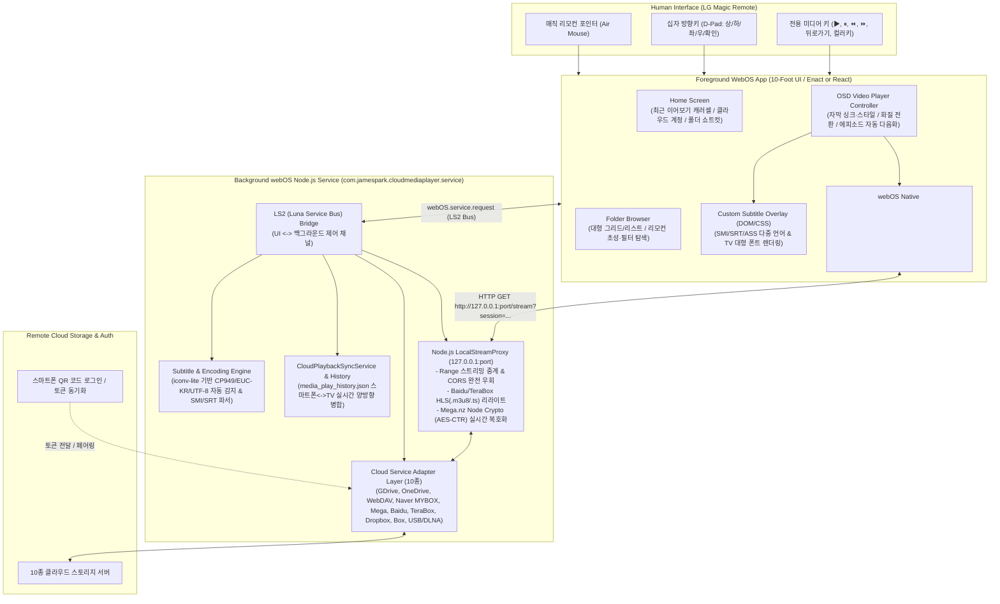

# LG webOS 스마트 TV용 Cloud Media Player 개발 마스터 플랜 (Architecture & Development Plan)

> [!IMPORTANT]
> 본 문서는 기존 안드로이드/윈도우용 [`cloud_media_player`](file:///D:/My%20Documents/AI/cloud_media_player)에서 이미 검증된 **비즈니스 로직 플로우(멀티 클라우드 연동, 로컬 스트림 프록시, 툼스톤 기반 이어보기 동기화, 한국어 자막 자동 매칭/인코딩 변환, 심리스 화질 전환)**를 그대로 계승하면서, **LG 전자 webOS 스마트 TV의 하드웨어 아키텍처(SoC 하드웨어 미디어 파이프라인)와 휴먼 인터페이스(10-Foot UI & 매직 리모컨)**에 맞춰 **webOS 네이티브(Web App + Node.js JS Service)**로 새롭게 구축하기 위한 종합 설계 및 개발 계획서입니다.

---

## 1. 왜 안드로이드 앱 단순 포팅이 아닌 'webOS 네이티브' 재설계인가?

Gemini와의 상담 결과처럼, 기존 Flutter/Android 앱을 webOS로 단순 포팅(또는 일반 웹 빌드 이식)할 경우 다음과 같은 치명적인 한계에 부딪히며, **검증된 로직 플로우만 이식하고 webOS 네이티브 구조로 개발하는 것**이 유일하고도 가장 확실한 해법입니다.

| 비교 영역 | 기존 Android / Flutter 앱 (`cloud_media_player`) | LG webOS 스마트 TV 네이티브 환경 | webOS 네이티브 재설계 전략 |
| :--- | :--- | :--- | :--- |
| **재생 엔진 및 H/W 가속** | `media_kit` (`libmpv` C++ 네이티브 바인딩)으로 소프트웨어/하드웨어 디코딩 직접 제어 | TV용 저전력 ARM SoC + **전용 하드웨어 디코더(Starfish Media Pipeline)**. Canvas/WASM 기반 렌더러 사용 시 4K/HEVC 재생 불가 및 심각한 프레임 드랍 발생 | webOS 네이티브 `<video>` 태그(Starfish H/W 파이프라인 직결) + `Luna Service API`(`com.webos.media`) + `hls.js` 조합으로 **CPU 점유율 최소화 및 4K/HDR 하드웨어 가속 100% 활용** |
| **로컬 프록시 및 CORS 우회** | Dart VM `HttpServer` (`LocalStreamProxy`)가 `127.0.0.1`에서 인증 헤더 주입, Mega AES-CTR 복호화, HLS 리라이트 수행 | 브라우저(UI) 단만으로는 Google Drive/Baidu/TeraBox/WebDAV의 **CORS 차단 및 커스텀 헤더(`User-Agent`, `Referer`, `Cookie`) 주입 불가** | webOS 패키지에 내장되는 백그라운드 데몬인 **webOS Node.js Service (`JS Service`)**에서 `LocalStreamProxy` 로직을 1:1 재구현 (`127.0.0.1` 로컬 스트림 중계 및 Node `crypto` 고속 복호화) |
| **휴먼 인터페이스 (HI / UX)** | 스마트폰/태블릿 **터치스크린 (1-Foot UI)**: 상하 드래그(볼륨/명암비), 좌우 더블탭, 작은 아이콘 터치 | 거실 소파 환경 **10-Foot UI & LG 매직 리모컨**: 에어마우스 포인터(커서)와 십자 방향키(D-Pad)를 수시로 오가는 하이브리드 조작 | **LG Enact (`@enact/sandstone`)** 또는 **React + Spatial Navigation** 적용. 3m 거리 가독성 타이포그래피, 포커스 링(Focus Ring), 리모컨 전용 단축키(컬러 버튼, 재생/일시정지, Back 버튼) 완벽 대응 |
| **OAuth 로그인 및 계정 입력** | 모바일 인앱 브라우저(`google_sign_in`, WebView) 및 가상 키보드로 직접 로그인 | TV 리모컨으로 긴 아이디/비밀번호/2단계 인증을 입력하는 것은 극도로 불편하며, TV 내장 브라우저는 OAuth 보안 정책에 의해 차단됨 | **1순위**: 기존 안드로이드 앱과 연동된 클라우드에서 설정/계정 토큰 안전 가져오기 또는 **QR 코드(스마트폰 스캔 / OAuth Device Flow)** 인증으로 리모컨 타이핑 제로(Zero)화 |

---

## 2. 전체 시스템 아키텍처 (webOS Native Architecture)

LG webOS 앱은 크게 화면과 리모컨 입력을 담당하는 **Foreground Web App**과, 백그라운드에서 Node.js 런타임으로 동작하며 네트워크/파일시스템/복호화를 수행하는 **Background JS Service**의 결합(IPK 패키지)으로 구성됩니다.



---

## 3. 안드로이드 검증 로직 플로우 $\rightarrow$ webOS 네이티브 1:1 이식 매핑

기존 [`cloud_media_player`](file:///D:/My%20Documents/AI/cloud_media_player)의 핵심 자산인 검증된 플로우를 손실 없이 JavaScript/TypeScript 및 Node.js 환경으로 이식합니다.

### 3.1 멀티 클라우드 인터페이스 (`CloudService` 계층)
- **원본 검증 로직**: [`cloud_service_interface.dart`](file:///D:/My%20Documents/AI/cloud_media_player/lib/services/cloud_service_interface.dart) 및 10개 구현체 (`GoogleDriveService`, `OneDriveService`, `WebDavService`, `NaverBoxService`, `MegaService`, `BaiduService`, `TeraboxService`, `DropboxService`, `BoxService`, `LocalDiskService`)
- **webOS 이식 방식**:
  - TypeScript 인터페이스 `ICloudService`로 표준 메서드(`listItems`, `getStreamUrl`, `getStreamUrlWithQuality`, `getAvailableQualities`, `getStreamHeaders`, `refreshTokensIfNeeded`, `downloadBytes`)를 동일하게 정의합니다.
  - 모든 클라우드 API 통신은 브라우저가 아닌 **Node.js JS Service**에서 수행하여, Baidu(`User-Agent: netdisk...`), TeraBox(`Cookie: ndus=...`), Naver MYBOX 등의 민감한 커스텀 헤더 제약과 CORS 문제를 원천 해결합니다.
  - `LocalDiskService`는 TV의 **외장 USB 하드디스크/메모리(`com.webos.service.attachedstoragemanager`)** 탐색으로 매핑합니다.

### 3.2 로컬 스트림 프록시 (`LocalStreamProxy`)
- **원본 검증 로직**: [`local_stream_proxy.dart`](file:///D:/My%20Documents/AI/cloud_media_player/lib/services/local_stream_proxy.dart)
- **webOS 이식 방식 (`NodeStreamProxy`)**:
  1. **HTTP Range 중계 & 만료 토큰 무음 갱신**: TV의 `<video>` 태그가 보내는 `Range: bytes=xxx-` 요청을 가로채어, 토큰 만료 시 `refreshTokensIfNeeded()`를 자동 수행한 뒤 클라우드 서버로 파이핑(`res.pipe()`)합니다.
  2. **Mega.nz 실시간 복호화**: Dart의 `pointycastle`로 처리하던 AES-128-CTR 스트림 복호화를 Node.js 내장 C++ 네이티브 모듈인 `crypto.createDecipheriv('aes-128-ctr', key, iv)` 스트림 파이프라인으로 대체합니다. (Dart 대비 TV CPU 부하가 훨씬 낮아 대용량 고화질 영상 탐색이 즉각적임)
  3. **Baidu / TeraBox HLS (`.m3u8` / `.ts`) 리라이트**: M3U8 매니페스트 내의 상대/절대 세그먼트 경로를 `http://127.0.0.1:{port}/hls_segment?...`로 재작성하여 인증 쿠키와 전용 UA가 모든 세그먼트 요청에 유지되도록 동일한 플로우를 적용합니다.

### 3.3 디바이스 간 이어보기 양방향 동기화 (`CloudPlaybackSyncService`)
- **원본 검증 로직**: [`cloud_playback_sync_service.dart`](file:///D:/My%20Documents/AI/cloud_media_player/lib/services/cloud_playback_sync_service.dart) & [`playback_history_service.dart`](file:///D:/My%20Documents/AI/cloud_media_player/lib/services/playback_history_service.dart)
- **webOS 이식 방식**:
  - 클라우드 루트의 **`media_play_history.json` 포맷(버전 2, `histories` 배열 및 `deletedRecords` 툼스톤 맵)을 100% 동일하게 공유**합니다.
  - **핵심 사용자 시나리오**: 외출 중 스마트폰(갤럭시)에서 보던 영상을 지하철에서 42분 15초까지 시청하고 집에 돌아와 **LG 스마트 TV 앱을 켜면, 홈 화면 최상단 '이어보기'에 42분 15초 진도와 기존에 선택한 자막 설정이 그대로 나타나며 리모컨 확인(OK) 버튼 한 번으로 거실 대화면에서 바로 이어서 재생**됩니다. 반대로 TV에서 시청 후 끄면 스마트폰에도 즉시 반영됩니다.

### 3.4 한국어 자막 자동 탐색 및 인코딩 파서 (`SubtitleUtils`)
- **원본 검증 로직**: [`subtitle_utils.dart`](file:///D:/My%20Documents/AI/cloud_media_player/lib/utils/subtitle_utils.dart) & [`custom_subtitle_view.dart`](file:///D:/My%20Documents/AI/cloud_media_player/lib/ui/widgets/custom_subtitle_view.dart)
- **webOS 이식 방식**:
  - 영상 재생 시작 시 동일 폴더 내 파일 목록에서 `isSubtitleForVideo()` 및 `koreanScore()` 점수 산출 로직을 그대로 실행해 최적의 한국어 자막(`.smi`, `.srt`, `.ass`, `.vtt`)을 자동 로드합니다.
  - `iconv-lite`를 사용해 CP949 / EUC-KR / UTF-8 / UTF-16 인코딩을 자동 판별·변환하고, `<video>` 태그의 기본 자막 렌더러 대신 **커스텀 HTML/CSS 자막 오버레이 레이어**를 사용하여 TV 시청 거리(3m)에 최적화된 외곽선, 반투명 배경 박스, 하단 여백 조절, 싱크 조절($\pm 0.5$초 단위)을 완벽히 재현합니다.

### 3.5 프레임 동기화 기반 심리스 화질 전환 (Seamless Quality Switch)
- **원본 검증 로직**: [`player_screen.dart`](file:///D:/My%20Documents/AI/cloud_media_player/lib/ui/screens/player_screen.dart) & [`SEAMLESS_RESOLUTION_SWITCH_PLAN.md`](file:///D:/My%20Documents/AI/cloud_media_player/SEAMLESS_RESOLUTION_SWITCH_PLAN.md)
- **webOS 이식 방식**:
  - 주의점: 일반 PC/모바일과 달리 대부분의 LG webOS TV 하드웨어 디코더는 **동시에 2개의 고해상도 하드웨어 `<video>` 파이프라인(Dual Decoder)을 열면 리소스 충돌로 화면이 깨지거나 이전 디코더가 강제 해제**됩니다.
  - **webOS 최적화 플로우**:
    1. HLS 스트림(`hls.js` 사용 가능 스트림)의 경우: `hls.currentLevel` / `hls.nextLevel` API를 통해 디코더 재초기화 없이 버퍼 경계에서 무결점 화질 전환.
    2. MP4 Direct / 커스텀 스트림의 경우: 전환 직전 현재 `<video>` 프레임을 `<canvas>`에 캡처하여 화면 최상단에 고정(Freeze-Frame Overlay) $\rightarrow$ 단일 `<video>` 엘리먼트의 `src`를 신규 화질 프록시 URL로 교체 후 이전 타임스탬프로 즉시 `currentTime` 시크 $\rightarrow$ `seeked` 및 첫 프레임 디코딩(`loadeddata`/`timeupdate`) 완료 시점에 `<canvas>` 오버레이를 해제하여 검은 화면 깜빡임(Flicker)을 완벽히 차단합니다.

---

## 4. 휴먼 인터페이스 (10-Foot UI & LG 매직 리모컨) 설계

모바일 터치 UI를 TV용으로 바꿀 때 가장 중요한 **UX 전환 설계**입니다.

### 4.1 LG 매직 리모컨 키 매핑 (Key Binding Matrix)
| 리모컨 입력 | 키 코드 (`keyCode`) | 파일 탐색 화면 (Browser) 동작 | 비디오 플레이어 (Player) 동작 |
| :--- | :--- | :--- | :--- |
| **십자키 좌 / 우** | `37` / `39` | 그리드/리스트 항목 간 포커스 이동 | OSD 숨김 시: **즉시 $-\text{10초} / +\text{10초}$ 탐색 (연타 시 누적 탐색)**<br>OSD 표시 시: 컨트롤 버튼 간 포커스 이동 |
| **십자키 상 / 하** | `38` / `40` | 상하 항목 포커스 이동 (페이지 스크롤) | OSD 숨김 시: 상(자막 싱크/화질 빠른 메뉴), 하(재생목록/에피소드 서랍 호출) |
| **확인 (휠 클릭 / OK)** | `13` | 폴더 진입 / 미디어 재생 시작 | OSD 숨김 시: OSD 표시 + 재생/일시정지 토글<br>OSD 표시 시: 현재 포커스된 버튼 실행 |
| **매직 리모컨 휠 스크롤** | `wheel` | 폴더/파일 리스트 고속 스크롤 | 타임라인 바 위에서 스크롤 시 정밀 탐색 |
| **뒤로 가기 (Back)** | `461` | 상위 폴더로 이동 (루트에서는 홈 화면으로 이동, 홈에서는 종료 확인 팝업) | OSD/팝업 열림 시: OSD/팝업 닫기<br>OSD 닫힘 시: 재생 위치 저장 후 탐색 화면으로 복귀 |
| **재생 / 일시정지 / 빨리감기** | `415`, `19`, `417`, `412` | 마지막 시청 영상 즉시 이어보기 | OSD 유무와 무관하게 즉각 재생 / 일시정지 / 탐색 제어 |
| **컬러 버튼 (빨/초/노/파)** | `403`, `404`, `405`, `406` | 🔴계정 전환 / 🟢동기화 새로고침 / 🟡폴더 즐겨찾기 등록 / 🔵정렬 방식 변경 | 🔴자막 선택 및 온오프 / 🟢자막 싱크 조절($-0.5\text{s}/+0.5\text{s}$) / 🟡화질 변경 / 🔵화면 비율·배속 변경 |

### 4.2 QR 코드 & 클라우드 설정 연동 (리모컨 타이핑 제로 시스템)
TV 리모컨으로 Google, OneDrive, Baidu, Naver, WebDAV 비밀번호나 쿠키를 입력하는 불편함을 없애기 위해 **2가지 스마트 연동 방식**을 도입합니다:
1. **스마트폰 로컬 QR 페어링 (Companion Web Form)**:
   - TV에서 `[+ 계정 추가 / 관리]`를 누르면 Node.js JS Service가 로컬 네트워크(`http://192.168.x.x:port/setup`)에 임시 설정 웹페이지를 열고 화면에 **QR 코드**를 띄웁니다.
   - 사용자가 스마트폰 카메라로 QR을 스캔하면 스마트폰 브라우저에서 익숙한 터치 키보드로 클라우드 로그인(또는 기존 안드로이드 앱의 계정 내보내기 JSON 붙여넣기/업로드)을 수행하고, 완료 즉시 TV에 모든 계정이 등록됩니다.
2. **클라우드 마스터 백업 연동**:
   - WebDAV나 Google Drive(Device Flow 인증) 하나만 연결하면, 암호화된 계정 설정 파일(`cloud_accounts_vault.enc`)을 통해 나머지 9개 클라우드 계정 정보를 한 번에 불러올 수 있습니다.

---

## 5. 프로젝트 디렉터리 구조 (`D:\My Documents\AI\cloud_media_player_webos`)

워크스페이스 규칙에 따라 향후 실제 코드 작업 시 생성할 프로젝트 구조입니다.

```text
D:\My Documents\AI\cloud_media_player_webos\
├── appinfo.json                        # webOS 앱 메타데이터 (해상도 1920x1080/3840x2160, 권한 설정)
├── package.json                        # 빌드 및 패키징 스크립트 (ares-package 연동)
├── frontend/                           # Foreground Web App (Enact Sandstone 또는 React + TypeScript)
│   ├── src/
│   │   ├── components/
│   │   │   ├── FocusableCard.tsx       # 매직 리모컨 커서 + 방향키 포커스 지원 카드
│   │   │   ├── VideoPlayerOSD.tsx      # 10-Foot 전용 플레이어 컨트롤러 & 컬러키 가이드 바
│   │   │   ├── CustomSubtitleOverlay.tsx # TV 대화면 최적화 자막 렌더러
│   │   │   └── QrPairingModal.tsx      # 스마트폰 QR 계정 등록 모달
│   │   ├── views/
│   │   │   ├── HomeView.tsx            # 이어보기 캐러셀 + 클라우드/쇼트컷 대시보드
│   │   │   ├── BrowserView.tsx         # 클라우드 폴더 탐색기
│   │   │   └── PlayerView.tsx          # H/W 비디오 플레이어 & Freeze-Frame 화질 전환기
│   │   ├── services/
│   │   │   └── lunaClient.ts           # Background JS Service 호출용 LS2 래퍼
│   │   └── hooks/
│   │       └── useRemoteKeys.ts        # LG 리모컨 키코드(461, 403~406 등) 및 포인터 상태 훅
├── service/                            # Background Node.js Service (com.jamespark.cloudmediaplayer.service)
│   ├── services.json                   # webOS LS2 서비스 선언 파일
│   ├── package.json                    # iconv-lite, xml2js 등 경량 의존성
│   ├── src/
│   │   ├── index.ts                    # webos-service 엔트리포인트 및 Keep-Alive 관리
│   │   ├── proxy/
│   │   │   ├── localStreamProxy.ts     # 127.0.0.1 Range 프록시, HLS 리라이트, Mega AES-CTR 복호화
│   │   │   └── companionQrServer.ts    # 스마트폰 QR 계정 입력용 로컬 LAN 웹 서버
│   │   ├── clouds/                     # 안드로이드에서 검증된 10종 클라우드 로직 1:1 이식
│   │   │   ├── cloudServiceInterface.ts
│   │   │   ├── googleDriveService.ts
│   │   │   ├── onedriveService.ts
│   │   │   ├── webdavService.ts
│   │   │   ├── naverBoxService.ts
│   │   │   ├── megaService.ts
│   │   │   ├── baiduService.ts
│   │   │   ├── teraboxService.ts
│   │   │   ├── dropboxService.ts
│   │   │   └── boxService.ts
│   │   ├── sync/
│   │   │   ├── playbackHistoryService.ts
│   │   │   └── cloudPlaybackSyncService.ts # media_play_history.json 양방향 병합 엔진
│   │   └── utils/
│   │       ├── subtitleUtils.ts        # 한국어 자막 점수 산출, CP949/UTF-8 변환, SMI/SRT 파서
│   │       └── megaCryptoUtils.ts      # Node.js crypto 기반 고속 AES-CTR/CBC 유틸리티
└── scripts/
    ├── build-ipk.ps1                   # 프론트엔드 + JS 서비스 통합 빌드 및 .ipk 패키징 스크립트
    └── deploy-tv.ps1                   # 집에 있는 LG TV로 원클릭 설치 및 실행 (ares-install / ares-launch)
```

---

## 6. 단계별 개발 로드맵 (Phased Implementation Plan)

### Phase 1: 개발 환경 구축 및 webOS 스켈레톤 세팅 (1단계)
- [ ] PC에 `@webos-tools/cli` (`ares-cli`) 설치 및 집의 LG 스마트 TV **Developer Mode(개발자 모드)** 연동 등록 (`ares-setup-device`).
- [ ] `D:\My Documents\AI\cloud_media_player_webos` 프로젝트 생성 (Frontend UI + Background Node.js Service 멀티 패키지 구성).
- [ ] 백그라운드 서비스가 동영상 재생 중 webOS의 유휴 타이머(Idle Timeout)에 의해 종료되지 않도록 `activityManager` Keep-Alive 구독 설정.

### Phase 2: 백그라운드 코어 엔진 및 `LocalStreamProxy` 이식 (2단계)
- [ ] `LocalStreamProxy`를 Node.js `http.Server`로 이식 (`Range` 헤더 포워딩, 만료 토큰 자동 갱신, 세션 관리).
- [ ] 스마트폰 QR 코드 스캔 기반 **로컬 계정 주입 서버(`companionQrServer`)** 구현: 기존 안드로이드 앱의 계정 데이터나 새 클라우드 계정을 리모컨 타이핑 없이 등록.
- [ ] 주요 클라우드 어댑터 순차 이식:
  - **2-1순위**: WebDAV, Google Drive, OneDrive, Naver MYBOX
  - **2-2순위**: Mega.nz (`crypto` 스트림 복호화), Baidu & TeraBox (HLS 리라이트 및 전용 헤더 처리), Dropbox, Box

### Phase 3: 10-Foot TV UI 및 매직 리모컨 네비게이션 구현 (3단계)
- [ ] **대시보드 홈 화면 (`HomeView`)**:
  - 최상단에 스마트폰과 동기화된 **'이어보기(Continue Watching)' 대형 썸네일 캐러셀** 배치.
  - 하단에 등록된 클라우드 계정 카드 및 자주 가는 폴더 쇼트컷(`FolderShortcut`) 그리드 배치.
- [ ] **폴더 탐색기 (`BrowserView`)**:
  - 매직 리모컨 커서 호버(Hover)와 십자 방향키(D-Pad) 이동이 충돌 없이 자연스럽게 이어지는 Spatial Navigation 적용.
  - 뒤로 가기 키(`keyCode: 461`) 히스토리 스택 처리 (`window.history` 및 커스텀 라우터 연동).

### Phase 4: webOS H/W 비디오 플레이어 & 자막/동기화 완성 (4단계)
- [ ] **webOS 네이티브 `<video>` + `hls.js` 플레이어 연동**:
  - 4K/HEVC 하드웨어 디코딩 확인, 리모컨 좌/우 방향키 즉시 탐색(낙관적 UI 반응), 자동 다음 에피소드 재생 구현.
  - `<canvas>` Freeze-Frame을 활용한 **깜빡임 없는 화질 전환(Seamless Quality Switch)** 구현.
- [ ] **한국어 자막 엔진 (`SubtitleUtils` & `CustomSubtitleOverlay`)**:
  - 동일 폴더 내 `.smi`/`.srt` 자동 매칭, `iconv-lite` 한글 인코딩(CP949/EUC-KR) 깨짐 방지, 리모컨 초록색 버튼(`404`)을 통한 실시간 자막 싱크 조절.
- [ ] **클라우드 재생 기록 양방향 동기화 (`CloudPlaybackSyncService`)**:
  - 앱 시작 시 / 재생 시작 시 / 일시정지 및 종료 시 `media_play_history.json` 자동 Pull & Merge & Push 연동.

### Phase 5: 실기기(LG TV) 배포, 테스트 및 최적화 (5단계)
- [ ] `.ipk` 패키지 빌드 및 집 LG 스마트 TV에 설치(`ares-install`).
- [ ] 장시간(2시간 이상) 영화 스트리밍 시 메모리 누수 여부, 토큰 만료 시 무중단 갱신 여부, 화면 보호기(Screensaver) 진입 방지 동작 검증.

---

## 7. LG webOS TV 실기기 설치 및 테스트 가이드 (사전 준비 사항)

실제 개발 착수 시 집에 있는 LG TV와 PC를 연결하는 절차는 매우 간단합니다:
1. **LG TV 설정**: TV의 `LG Content Store (앱스)`에서 **`Developer Mode`** 앱을 검색해 설치하고, LG 개발자 계정으로 로그인하여 **Dev Mode Status를 ON**으로 켭니다.
2. **Key Server 활성화**: TV의 Developer Mode 앱 화면에서 **`Key Server`**를 켜고 화면에 표시된 `Passphrase`(6자리 영문/숫자)와 `TV IP 주소`를 확인합니다.
3. **PC에서 원클릭 연결**:
   ```powershell
   # 1. 글로벌 webOS CLI 도구 설치
   npm install -g @webos-tools/cli

   # 2. 집 TV 등록 및 SSH 키 가져오기
   ares-setup-device
   ares-novacom --device mytv --getkey

   # 3. 패키징 및 TV 즉시 설치/실행
   ares-package ./dist ./service -o ./out
   ares-install --device mytv ./out/com.jamespark.cloudmediaplayer_1.0.0_all.ipk
   ares-launch --device mytv com.jamespark.cloudmediaplayer
   ```
